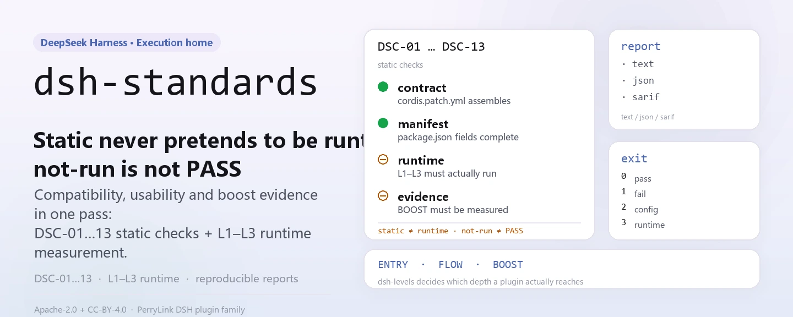
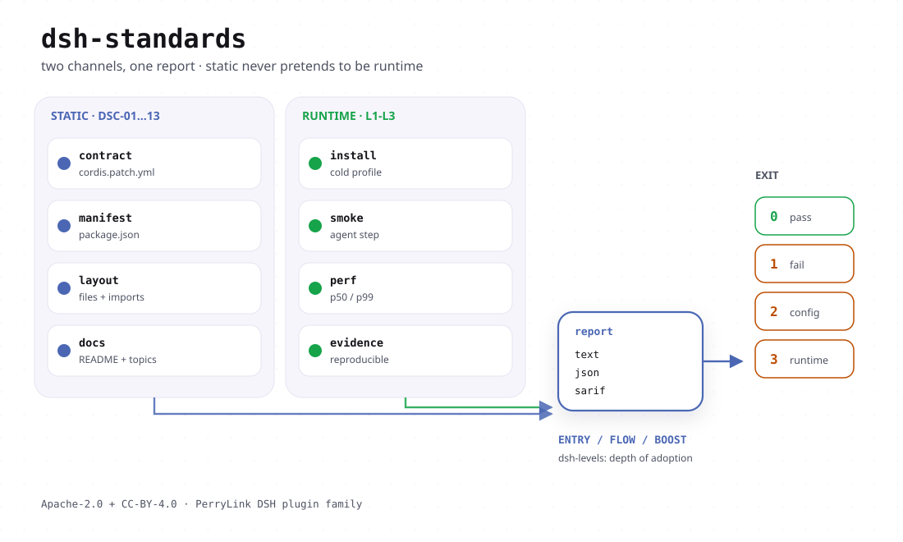

<div align="center">

<picture>
  <source media="(prefers-color-scheme: dark)" srcset="docs/assets/dsh-standards-hero-en-dark.webp">
  
</picture>

# dsh-standards

**Find out a DSH plugin's compatibility, usability, and efficiency evidence in one command — static never poses as runtime, and `not-run` never counts as PASS.**

The execution home for the three DSH adoption levels (ENTRY / FLOW / BOOST): the checker, the level audit, and the canonical specification text all live here; the prose guide is [dsh-plugin-guide](https://github.com/PerryLink/dsh-plugin-guide) and the low-level clause text stays in [dsh-plugin-spec](https://github.com/PerryLink/dsh-plugin-spec).

[Install](#three-step-setup) · [Configuration](#configuration) · [FAQ](#faq) · [简体中文](README.md) · [English](README.en.md) · [Español](README.es.md) · [Português](README.pt.md) · [हिन्दी](README.hi.md)

[](LICENSE)
[](https://www.npmjs.com/package/dsh-standards)
[](#three-step-setup)

[](https://github.com/PerryLink/dsh-standards/stargazers)
[](https://www.npmjs.com/package/dsh-standards)
[](https://gitee.com/perrylink/dsh-standards)

```sh
npm i -g dsh-standards                                        # global: dsh-standards + dsh-levels
npx dsh-standards <plugin-dir> --scope entry --entry-claim static   # or run it without installing
```

</div>

<sub>Community project, not affiliated with DeepSeek: non-official, not a certification, not a security audit, no official endorsement. `DeepSeek Harness` is a DeepSeek trademark; this project only uses the `DSH` abbreviation. Canonical repository: <https://github.com/PerryLink/dsh-standards> (Gitee is a mirror).</sub>

## What it is

This repository does not ship plugins. It builds the ruler, then measures with it.

DSH adoption depth has three levels, each with its own question and evidence vocabulary, and they are **never collapsed into one score**:

| Layer | Specification / practice | Question it answers | Current state |
|---|---|---|---|
| 1 | **DSH-ENTRY basics** | Can an existing plugin be recognized, installed, and booted without changing its code? | 18/18 `recognized`; base-only 10/18 carry runtime evidence (8 clean + 2 reject); real web profile 16/18 warning-free with 2 host-gate rejects (self-assessed, no independent review); client 15/15 loaded; 18/18 clean not achieved |
| 2 | **DSH-FLOW smoothness** | Can a user install, configure, use, recover, upgrade, and uninstall the plugin without surprises? | draft; J1/J2/J4/J6 **12 PASS** on fixtures; J3/J7 fixture runtime; J5/J8 static preflight; 10 real packages **78 PASS / 4 FAIL / 2 blocked / 66 not-run** |
| 3 | **DSH-BOOST acceleration** | Does the plugin use Cordis primitives (effect, inject, volatile, events, seams, jobs, bounded parallelism) to make development and use measurably cheaper? | draft; LEV-1–8 **8/8 measured** (loader / context / provider-capture / synthetic timer; not a production baseline) |

Three things live here: `40-checker/` (the DS-C conformance checker plus every evidence script), `bin/` (two public entry points, `dsh-standards` and `dsh-levels`), and `spec/` with the canonical clause text in the numbered `31`–`35` documents. The tools only read the target package and never modify what they inspect; the verdict only accepts evidence, so `not-run`, `NA`, and `static` are never written up as PASS.

The old npm reservation `dsh-standards@0.0.3` only held the name; this 1.x line replaces it (currently `1.1.2`), and the two bins are `dsh-standards` and `dsh-levels`.

Fixed anchor, recorded in `spec/levels.json` and in every report: `repo=deepseek-ai/deepseek-harness`, `commit=ce7073d51254`, `dsh=0.2.2-alpha.2`, `cordis=4.0.6-alpha.1`. Pass a different runtime version explicitly and the report records which ruler you measured with.

### Upstream and usage (facts, 2026-11)

- **dsh-plugin-hub** — a version-aware npm metadata check is on main ([`4f3a560`](https://github.com/dshplugin/dsh-plugin-hub/commit/4f3a560), 2026-11-09). Scope: install-time npm metadata only (package/version existence and the `repository` back-link); it does not run ENTRY and is not an endorsement of any plugin.
- **Usage** (npm registry, 2026-11): `dsh-plugin-guide` ~12.6k/month, `dsh-standards` ~4.4k/month, `dsh-plugin-start` ~1.65k/month. Downloads are not unique users and are not a ranking, certification, or security claim.
- **Toolchain**: `dsh-plugin-guide` (guide / skill), `dsh-plugin-start` (scaffolder with the check and an advisory CI snippet in its output), `dsh-check-action` (read-only ENTRY Action), `dsh-plugin-spec` (clause text), `dsh-primer` (older development skill / CLI).

### Current hard numbers

- 18 packages, entry static: **18/18 recognized, 0 clean**;
- 18 packages, DS-C static: **0 PASS / 9 WARN / 9 FAIL**;
- 18 packages, base-only runtime: **18/18 raw JSON present; 10/18 G3 verified, 8 partial, 0 error**; after the host gate **8 clean + 2 reject + 8 partial**;
- client runtime: **15/15 `client-module-loaded`** (real Chromium); web-app **4/4 loaded**;
- unusable: **0 plugin code FAIL; 2 host-gate rejects (telemetry/verification)**;
- checker self-test: **128/128 tests** (locally via `node --test 40-checker/test/*.test.mjs`; includes governance, DCO, attestation, claim, verification, chain, and drift tests);
- J1: **6 PASS + 1 WARN**; LEV-3: volatile **0/20** vs control **20/20** remount; LEV-6: stable prefix **100%** vs volatile **0%**; LEV-7: **8.24×** (synthetic, not a production baseline).

These numbers are self-assessment plus the repository's evidence chain, not a third-party review — the report's `notClaimed` field lists exactly what is not claimed: official standard, certification, security audit, ranking, production baseline.

<details>
<summary>Repository map (the numbered 00–99 specs are written in Chinese)</summary>

- [START-HERE.md](START-HERE.md) — the one-page entry for a new session
- [docs/DEVELOPER-JOURNEY.md](docs/DEVELOPER-JOURNEY.md) — the plugin lifecycle and toolchain
- [spec/levels.json](spec/levels.json) — the machine source of truth for the three levels
- [scheme/SCHEME-v1.md](scheme/SCHEME-v1.md) — the A–E / A–D evaluation scheme and rubric
- [evidence/README.md](evidence/README.md) — the append-only evidence chain and how to re-run it
- [GOVERNANCE.md](GOVERNANCE.md) · [CONTRIBUTING.md](CONTRIBUTING.md) · [SECURITY.md](SECURITY.md) · [MODIFICATION-POLICY.md](MODIFICATION-POLICY.md)
- [RENAMES.md](RENAMES.md) — old-name to new-repository map
- [P0-P2-STATUS.md](P0-P2-STATUS.md) — item-by-item DONE / PARTIAL / REPLACED

The full 51-document index lives in the Chinese [README.md](README.md).

</details>

<picture>
  <source media="(prefers-color-scheme: dark)" srcset="docs/assets/dsh-standards-flow-v4-dark.svg">
  
</picture>

## Three-step setup

**1. Install** (either way; Node `>=24.9.0`):

```sh
# global install: both dsh-standards and dsh-levels land on PATH
npm i -g dsh-standards
# or run without installing anything
npx dsh-standards --version
npx -p dsh-standards dsh-levels --help
```

There is no build step: `bin/` and `40-checker/` are the shipped artifacts. The second npx command must use `-p dsh-standards`, because the bare npm names `dsh-levels` and `dsh-plugin-verify` belong to other projects.

**2. Run one check** (the target is a package directory containing `package.json`):

```sh
# entry compatibility: static recognition, no runtime claim
dsh-standards ./my-plugin --scope entry --entry-claim static

# full DS-C (default scope): JSON / SARIF 2.1.0 reports
dsh-standards ./my-plugin --format json --out report.json
dsh-standards ./my-plugin --format sarif --out report.sarif

# three-level audit: ENTRY runs automatically; FLOW / BOOST stay not-run / not-measured without evidence files
dsh-levels ./my-plugin --format json --out audit.json
```

**3. Read the verdict** — exit code first, then `status`:

```text
0  completed, no FAIL (PASS or WARN; WARN does not claim a clean PASS)
1  completed, at least one FAIL
2  incomplete: a mandatory check did not run, or the checker itself failed
3  usage error
```

Real output on this repository's fixture (trimmed):

```text
scope=entry profile=package status=pass exit=0
level: DSH-ENTRY recognized
DSC-01  PASS  C-1    L0
DSC-14  NA    C-14   L1     entry static claim: no runtime evidence
coverage: mandatory=5 pass=5 warn=0 fail=0 na=0 notRun=0
```

On the same fixture `dsh-levels` reports the three layer states — `entry.state=recognized`, `flow.state=not-run`, `boost.state=not-measured` — plus three `nextActions` lines telling you which evidence to supply next.

## Core capabilities

- **Static face (L0)**: never executes the target; reads the manifest, entry, patch, and sources, and decides `DSC-01`–`DSC-03` and `DSC-10`–`DSC-13`.
- **Runtime face (L1–L3)**: loads the package into a Cordis runtime inside an **isolated child process** and checks that it reaches ACTIVE, that the declared `provide` is actually registered, that effects form a topology, that unload returns to zero, and that restart is idempotent. A timeout is a hard kill, and a kill is `not-run`, never PASS.
- **Report face**: `text` / `json` / `sarif` (SARIF 2.1.0, ready for GitHub code scanning); each report carries an `anchor` (harness commit, dsh, cordis versions) — change the version and you are holding a different ruler.
- **Three-level audit**: `dsh-levels` maps the ENTRY checker verdict onto an evidence state and only reads J1–J8 (FLOW) and LEV-1–8 (BOOST) evidence files; without evidence it reports `not-run` / `not-measured`.
- **Read-only**: it does not modify the inspected package and writes nothing into the target directory; reports go to stdout or to `--out`.

### Checks

| ID | Clause | Layer | What it checks |
|---|---|---|---|
| `DSC-01` | C-1 | L0 | `manifest`, `name`, `version`, `license`, entry, `dsh.bundle.patch`, export shape |
| `DSC-02` | C-2 | L0 | `engines.dsh` or the `@deepseek-ai/dsh*` peer, satisfied by the runtime |
| `DSC-03` | C-3 | L0 | install spec, market index entry, supply-chain pinning |
| `DSC-04` | C-4 | L1 | loads to ACTIVE |
| `DSC-05` | C-5 | L1 | declared `provide` really registers |
| `DSC-06` | C-6 | L1+L2 | effect topology, private registration surface |
| `DSC-07` | C-7 | L2 | effects / stores / registries return to zero after unload |
| `DSC-08` | C-8 | L3 | restart idempotence plus cold restart |
| `DSC-09` | C-9 | L1 | declared vs measured cross-check |
| `DSC-10` | C-10 | L0 | import-time side effects (advisory, never FAIL) |
| `DSC-11` | C-11 | L0 | `dsh.capabilities` plus high-signal triggers |
| `DSC-12` | C-12 | L0 | credential backing file, `listRecords`, global seams; also reads the shape of `dsh.commitments` and `dsh.disclosure` |
| `DSC-13` | C-13 | L0 | `dsh.labels`, `upstream`, forbidden wording |

`--scope mvp` only covers 8 IDs (`DSC-03/10/11/12/13` are outside the MVP) and writes `subset: "MVP-13"` with `level: null` — that is **not** a DS-C pass.

### Which tool, when

| Stage | Command | Tool | Output |
|---|---|---|---|
| Start | `dsh-dev new` / `dsh-start new` | dsh-plugin-start | installable skeleton |
| Static precheck | `dsh-dev check` / `dsh-ready` | dsh-plugin-ready | static report (host `not-run`) |
| Host contract | `dsh-clinic --only R,K,X` | dsh-plugin-doctor/clinic | host contract |
| Isolated install | `dsh-test-drive` | dsh-test-drive | C3 evidence |
| Market submission | `entry-validate --host-evidence` | this repo's `40-checker` | C1–C8 + C3 |
| Tool management | `dsh-tools list/doctor/install` | dsh-plugin-tools | versions / install guidance |

The full journey is in [docs/DEVELOPER-JOURNEY.md](docs/DEVELOPER-JOURNEY.md), the tool family in [dsh-plugin-devtools](https://github.com/PerryLink/dsh-plugin-devtools), and the old-name map in [RENAMES.md](RENAMES.md).

## Configuration

There is no config file — every knob is a command-line flag. The two commands have separate sets: `dsh-standards <package-dir>` forwards to the DS-C checker (`--help` prints the full usage), and `dsh-levels <package-dir>` forwards to the three-level audit.

The eight you will actually use:

| Flag | Default | Meaning |
|---|---|---|
| `<package-dir>` | `.` | target package directory containing `package.json`; tarballs are not supported |
| `--scope` | `ds-c` | `mvp` = 8 MVP IDs; `ds-c` = full claim; `entry` = compatibility gate |
| `--format` | `text` | `text` / `json` / `sarif` (SARIF 2.1.0) |
| `--entry-claim` | `runtime` | `runtime` needs DSC-14 runtime evidence; `static` claims structural recognition only |
| `--host` | — | app-boot `lib/index.js`; required for the bundle G0–G3 smoke |
| `--profile` | `package` | `package` / `listing` / `both`; defaults to `listing` when `--market-index` is given |
| `--no-exec` | `false` | skip L1–L3 entirely, reported as `not-run` (never PASS) |
| `--out` | — | write the report to a file instead of stdout |

<details>
<summary>Full flag table (every dsh-standards switch)</summary>

| Flag | Default | Meaning |
|---|---|---|
| `--format` | `text` | report format: `text` / `json` / `sarif` |
| `--scope` | `ds-c` | check scope: `mvp` / `ds-c` / `entry` |
| `--profile` | `package` | evaluation profile: `package` / `listing` / `both` |
| `--runtime` | — | path to a built `@deepseek-ai/cordis` `lib/index.js`; enables L1–L3 |
| `--runtime-version` | `0.2.2-alpha.2` | dsh runtime version recorded in the anchor and used by C-2 |
| `--cordis-version` | `4.0.6-alpha.1` | cordis version recorded in the anchor |
| `--commit` | `ce7073d51254` | harness commit recorded in the anchor |
| `--install-spec` | — | recommended install spec for C-3 |
| `--market-index` | — | format-1 market index JSON; turns on listing mode |
| `--plugin-name` | — | plugin name inside the market index |
| `--timeout` | `10000` | L1–L3 timeout in ms (100–120000) |
| `--no-exec` | `false` | skip L1–L3 entirely, reported as `not-run` / `NA` |
| `--static-only` | `false` | M1 mode: only C-1/C-2/C-3/C-11/C-12/C-13 stay in scope, C-4–C-9 are out |
| `--treat-as-plugin` | `false` | run L1–L3 against a bundle's server entry |
| `--entry-runtime` | `require` | entry gate: full G0–G3, or accept the `server-entry` proxy |
| `--entry-claim` | `runtime` | entry gate: runtime evidence (DSC-14), or static recognition only |
| `--host` | — | app-boot `lib/index.js`; enables the bundle G0–G3 smoke |
| `--base` | — | base `cordis.patch.yml` for the bundle smoke |
| `--web` | — | web-app `cordis.patch.yml` for the bundle smoke |
| `--bare` | — | bare-module base directory for the host farm |
| `--out` | — | write the report to a file instead of stdout |
| `--help` / `--version` | — | print usage / print `dsh-standards <version> (checker 0.1.0)` |

`dsh-levels` flags:

| Flag | Default | Meaning |
|---|---|---|
| `<package-dir>` | required | target package directory containing `package.json` |
| `--host` | — | real G0–G3 boot for ENTRY |
| `--base` | — | base patch for the bundle smoke |
| `--bare` | — | bare-module farm for the bundle smoke |
| `--no-runtime` | `false` | stay static for ENTRY even when `--host` is given |
| `--flow-evidence` | — | J1–J8 evidence JSON; each entry has `status` set to `pass` / `fail` / `not-run` |
| `--boost-evidence` | — | LEV evidence JSON; a row with a status but no evidence card is downgraded to `not-measured` |
| `--timeout` | `150000` | checker timeout in ms |
| `--format` | `text` | `text` / `json` |
| `--out` | — | write the result to a file |

</details>

## FAQ

<details>
<summary>Is this a certification or a ranking?</summary>

No. The project describes itself as **non-official, not a certification, not a security audit**, and it does not represent an endorsement by DeepSeek; it charges no money and sells no levels or rankings. `A–D` are quality grades from `scheme/`, orthogonal to the `ENTRY` / `FLOW` / `BOOST` levels — neither reports nor docs merge them into one score. However strong the evidence, it is self-assessment plus an in-repo evidence chain, and the `notClaimed` field always lists "official standard / certification / security audit / ranking / production baseline".

</details>

<details>
<summary>What is the difference between `18/18 recognized` and `18/18 clean`?</summary>

`recognized` is a static recognition pass (`--entry-claim static`, structural claim only, no runtime claim). `clean` needs runtime evidence: base-only 10/18 carry runtime evidence (8 clean + 2 reject), the real web profile has 16/18 warning-free with 2 host-gate rejects, and all of that is self-assessed without independent review — so **18/18 clean is still not achieved**, and no document claims otherwise. Likewise, `client-module-loaded` means neither UI usability nor certification.

</details>

<details>
<summary>What happens without a DSH runtime installed? Does it pass silently?</summary>

It does not. L1–L3 need `--runtime` (and a bundle needs `--host`); without them the checks are reported as `ERR` / `not-run` with the reason inline (`no --runtime supplied; L1-L3 not run`), and under the package scope the conclusion becomes `incomplete` with exit `2`. `--scope entry --entry-claim static` still yields `DSH-ENTRY recognized`, but that is a static claim; pass `--runtime` or `--host` for a runtime verdict.

</details>

<details>
<summary>Does it touch my package? Can it break my code?</summary>

The checker only reads the target directory and never modifies it. When runtime checks run, loading happens in a **child process** with a hard kill on timeout (10s by default, adjustable with `--timeout`); a kill is recorded as `not-run`, not PASS, and the child cannot read the checker's own environment. Add `--no-exec` to skip execution entirely, or `--static-only` for a static-only verdict.

</details>

<details>
<summary>How does this relate to guide / doctor / cert / portal / catalog?</summary>

This repository is the specification text plus the checker and the level audit; the prose guide lives in `dsh-plugin-guide`, host-contract measurement lives in `dsh-plugin-doctor` (clinic), and the market and portal tools are separate. The role split and contribution paths are in the Chinese `39` document, and the selection table above summarises when to reach for which tool.

</details>

## Known limitations

- **No certification and no security audit.** A report is a quality signal, not a compliance proof; `A–D` are quality grades, not `ENTRY` / `FLOW` / `BOOST`.
- **No fees, no level sales, no ranking sales.**
- **Never writes static up as runtime.**
- **Never writes 10/18 base-only up as 18/18 web/production, and never writes `client-module-loaded` up as UI or certification.**
- **Never claims official recommendation or adoption, certification, accreditation, or a security audit.**
- **MVP coverage gap**: `--scope mvp` covers only 8 IDs (`DSC-03/10/11/12/13` are outside it); its verdict is `subset: "MVP-13"` with `level: null` and must not be used as a DS-C badge.
- **Package directories only**: the target must be a directory containing `package.json`; tarball support is not part of the MVP.
- **Runtime verdicts have prerequisites**: without `--runtime` or `--host`, L1–L3 can only be `not-run`, and `--entry-claim static` can never produce a runtime verdict.
- **Verdicts are anchored to versions**: change `commit` / `dsh` / `cordis` and you are holding a different ruler; an old report is not evidence for a new version.
- **BOOST numbers are not a production baseline**: the 8/8 measured LEV results come from loader / context / provider-capture / synthetic-timer environments, and the LEV-7 8.24× figure likewise.
- **Text changes must be declared**: copying or modifying text from this repository requires a prominent Change Notice (source commit, which clause, what changed, why, date), see [`MODIFICATION-POLICY.md`](MODIFICATION-POLICY.md); marks and badges are not licensed by the licenses above, see `governance/mark-policy.md`.

## Development

```sh
git clone https://github.com/PerryLink/dsh-standards.git
cd dsh-standards

node --test 40-checker/test/*.test.mjs                      # 128/128
node bin/dsh-standards.mjs 40-checker/fixtures/good \
  --scope entry --entry-claim static --format text          # fixture smoke
node bin/dsh-levels.mjs 40-checker/fixtures/good --format json

# straight to the checker from a source checkout
node 40-checker/bin/dsh-plugin-verify.mjs <plugin-dir> --scope entry --entry-claim static
node 40-checker/bin/dsh-plugin-verify.mjs <bundle-dir> --scope entry \
  --host /path/to/@deepseek-ai/dsh-app-boot/lib/index.js

node 40-checker/scripts/journey-runtime.mjs --package <dir> --json   # J1 install/uninstall journey
node 40-checker/scripts/governance-check.mjs                # governance clauses
node 40-checker/scripts/attestation-check.mjs               # attestation records
node 40-checker/scripts/claim-check.mjs                     # claim consistency
node 40-checker/scripts/dco-check.mjs --range HEAD~1..HEAD  # DCO
node publish/verify.mjs --id DSH-ATT-2026-001               # verify an example record

cd examples/boost && node lev7-bench.mjs 64 20              # LEV-7 bounded-parallelism benchmark
```

README images are generated programmatically by [`scripts/gen-readme-assets.py`](scripts/gen-readme-assets.py) (Python + Pillow, light and dark SVGs) and can be regenerated any time: `python scripts/gen-readme-assets.py`.

### Layout

```text
00-99*.md         specification / research / profile / communication docs
bin/              two public entry points: dsh-standards, dsh-levels
40-checker/       checker, J1 journeys, bundle smoke, samples, results
governance/       roles, contribution terms, mark policy, appeals, COI, decision log
adoption/         official / market / developer adoption packs
spec/             levels.json + clauses.json + schemas (evidence / report / attestation)
scheme/           A–E / A–D evaluation scheme and rubric
evidence/         append-only evidence chain and re-run instructions
examples/boost/   LEV-7 reference implementation and benchmarks
publish/          label examples + attestation record JSON
docs/             long-lived docs such as DEVELOPER-JOURNEY plus the README images
```

### Governance and contribution

- Roles and permissions: `governance/roles.json`; one-page summary: [GOVERNANCE.md](GOVERNANCE.md)
- Contribution: DCO 1.1 + DCT v1 (`dsh-ct/1`, a licence rather than a copyright assignment), see [CONTRIBUTING.md](CONTRIBUTING.md)
- Marks: `governance/mark-policy.md` (auto-granted, revocable, disclaimer required)
- Appeals: `governance/appeals.md`; AI only receives, times, and reviews — humans decide
- Three adoption packs: `adoption/{official,market,developer}/`

## Family and credits

This project is one member of the DSH ecosystem maintained by [PerryLink](https://github.com/PerryLink): this branch owns the ruler — the specification text, the checker, and the level audit — while the guide, scaffolding, verification, and portal tools have their own repositories. If it saved you a few manual cross-checks, **give it a star** — it unlocks nothing, but it helps the next person who has to verify a plugin find this repository.

The earlier project `dsh-plugin-standard` (lanbaolu) belongs to the same ecosystem and is not affiliated with this project; any reference or comparison will cite its source.

## License

- **Text / specifications / documentation / translations**: CC BY 4.0 ([`LICENSE-CC-BY`](LICENSE-CC-BY)); modifications must carry a Change Notice per [`MODIFICATION-POLICY.md`](MODIFICATION-POLICY.md);
- **Code / scripts / schemas**: Apache-2.0 ([`LICENSE-APACHE`](LICENSE-APACHE), including the patent grant and defensive termination);
- **Marks / badges**: separate rules in `governance/mark-policy.md`, not granted by the licenses above;
- **Contributions**: DCO 1.1 + DCT v1, with no copyright assignment.

<p align="center"><sub>CC BY 4.0 (text) · Apache-2.0 (code) · community project, not affiliated with DeepSeek.</sub></p>
