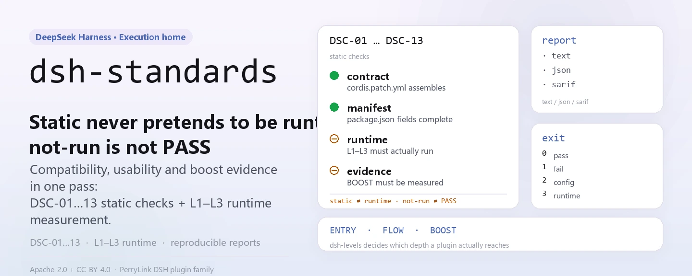
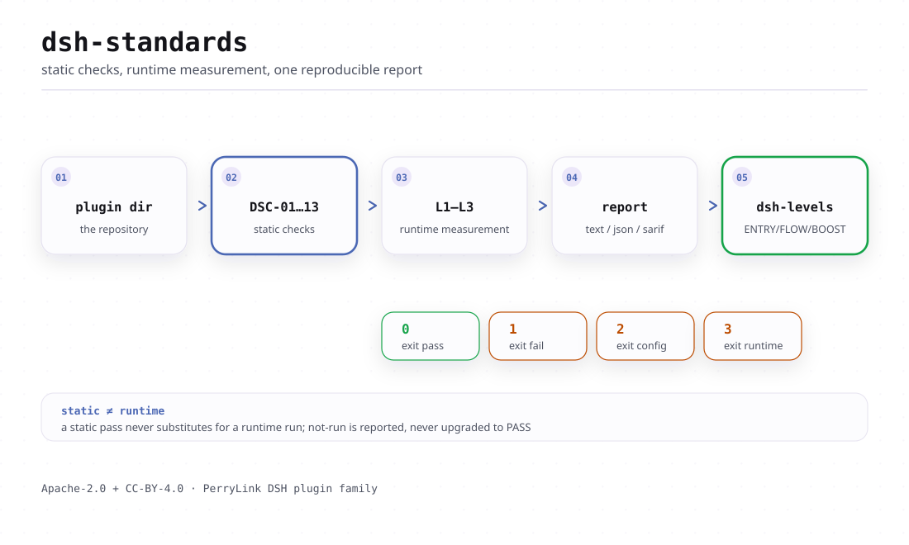

<div align="center">

<picture>
  <source media="(prefers-color-scheme: dark)" srcset="docs/assets/dsh-standards-hero-en-dark.webp">
  
</picture>

# dsh-standards

**Averigua en un solo comando la compatibilidad, la usabilidad y la evidencia de eficiencia de un plugin DSH: lo estático nunca se disfraza de runtime y `not-run` nunca cuenta como PASS.**

La sede de ejecución de los tres niveles de adopción de DSH (ENTRY / FLOW / BOOST): el verificador, la auditoría de niveles y el texto normativo viven aquí; la guía en prosa está en [dsh-plugin-guide](https://github.com/PerryLink/dsh-plugin-guide) y el texto de las cláusulas de bajo nivel sigue en [dsh-plugin-spec](https://github.com/PerryLink/dsh-plugin-spec).

[Instalar](#instalación-en-tres-pasos) · [Configuración](#configuración) · [FAQ](#faq) · [简体中文](README.md) · [English](README.en.md) · [Español](README.es.md) · [Português](README.pt.md) · [हिन्दी](README.hi.md)

[](LICENSE)
[](https://www.npmjs.com/package/dsh-standards)
[](#instalación-en-tres-pasos)

[](https://github.com/PerryLink/dsh-standards/stargazers)
[](https://www.npmjs.com/package/dsh-standards)
[](https://gitee.com/perrylink/dsh-standards)

```sh
npm i -g dsh-standards                                        # global: dsh-standards + dsh-levels
npx dsh-standards <plugin-dir> --scope entry --entry-claim static   # o sin instalar nada
```

</div>

<sub>Proyecto comunitario, sin afiliación con DeepSeek: no oficial, no es una certificación ni una auditoría de seguridad, y no cuenta con respaldo oficial. `DeepSeek Harness` es una marca de DeepSeek; este proyecto solo usa la abreviatura `DSH`. Repositorio canónico: <https://github.com/PerryLink/dsh-standards> (Gitee es un espejo).</sub>

## Qué es

Este repositorio no publica plugins. Construye la regla de medir y luego mide con ella.

La profundidad de adopción de DSH tiene tres niveles, cada uno con su pregunta y su vocabulario de evidencia, y **nunca se funden en una sola puntuación**:

| Nivel | Norma / práctica | Qué pregunta responde | Estado actual |
|---|---|---|---|
| 1 | **DSH-ENTRY, base de compatibilidad** | ¿Se puede reconocer, instalar y arrancar un plugin existente sin cambiar su código? | 18/18 `recognized`; base-only 10/18 con evidencia de runtime (8 clean + 2 reject); el perfil web real 16/18 sin avisos y 2 rechazos de host-gate (autoevaluación, sin revisión independiente); client 15/15 loaded; 18/18 clean no alcanzado |
| 2 | **DSH-FLOW, fluidez de uso** | ¿Puede el usuario instalar, configurar, usar, recuperar, actualizar y desinstalar el plugin sin sorpresas? | draft; J1/J2/J4/J6 **12 PASS** en fixtures; J3/J7 runtime de fixture; J5/J8 preflight estático; 10 paquetes reales **78 PASS / 4 FAIL / 2 blocked / 66 not-run** |
| 3 | **DSH-BOOST, aceleración** | ¿Usa el plugin las primitivas de Cordis (effect, inject, volatile, eventos, seams, jobs, paralelismo acotado) para abaratar de forma medible el desarrollo y el uso? | draft; LEV-1–8 **8/8 measured** (loader / context / provider-capture / synthetic timer; no es una línea base de producción) |

Aquí viven tres cosas: `40-checker/` (el verificador DS-C y todos los scripts de evidencia), `bin/` (dos puntos de entrada públicos, `dsh-standards` y `dsh-levels`) y `spec/` junto con el texto normativo de los documentos numerados `31`–`35`. Las herramientas solo leen el paquete objetivo y nunca modifican lo que inspeccionan; el veredicto solo acepta evidencia, así que `not-run`, `NA` y `static` jamás se escriben como PASS.

La antigua reserva de npm `dsh-standards@0.0.3` solo ocupaba el nombre; esta línea 1.x la sustituye (hoy `1.1.2`) y los dos bins son `dsh-standards` y `dsh-levels`.

Ancla fija, registrada en `spec/levels.json` y en cada informe: `repo=deepseek-ai/deepseek-harness`, `commit=ce7073d51254`, `dsh=0.2.2-alpha.2`, `cordis=4.0.6-alpha.1`. Si pasas otra versión de runtime, el informe deja constancia de con qué regla mediste.

### Cifras duras actuales

- 18 paquetes, entry static: **18/18 recognized, 0 clean**;
- 18 paquetes, DS-C static: **0 PASS / 9 WARN / 9 FAIL**;
- 18 paquetes, runtime base-only: **18/18 con JSON en bruto; 10/18 G3 verified, 8 partial, 0 error**; tras el host gate **8 clean + 2 reject + 8 partial**;
- runtime de client: **15/15 `client-module-loaded`** (Chromium real); web-app **4/4 loaded**;
- no utilizables: **0 plugin code FAIL; 2 rechazos de host-gate (telemetry/verification)**;
- autoprueba del verificador: **128/128 tests** (en local con `node --test 40-checker/test/*.test.mjs`; incluye gobernanza, DCO, registros de evaluación, declaraciones, verificación, cadena y deriva);
- J1: **6 PASS + 1 WARN**; LEV-3: volatile **0/20** frente a control **20/20** remount; LEV-6: prefijo estable **100%** frente a volátil **0%**; LEV-7: **8.24×** (sintético, no línea base de producción).

Estas cifras son autoevaluación más la cadena de evidencia del repositorio, no una revisión de terceros: el campo `notClaimed` del informe enumera exactamente lo que no se reclama (norma oficial, certificación, auditoría de seguridad, ranking, línea base de producción).

<details>
<summary>Mapa del repositorio (las especificaciones numeradas 00–99 están escritas en chino)</summary>

- [START-HERE.md](START-HERE.md) — la página de entrada para una sesión nueva
- [docs/DEVELOPER-JOURNEY.md](docs/DEVELOPER-JOURNEY.md) — ciclo de vida del plugin y cadena de herramientas
- [spec/levels.json](spec/levels.json) — fuente de verdad legible por máquina de los tres niveles
- [scheme/SCHEME-v1.md](scheme/SCHEME-v1.md) — esquema de evaluación A–E / A–D y rubric
- [evidence/README.md](evidence/README.md) — cadena de evidencia solo-añadir y cómo reproducirla
- [GOVERNANCE.md](GOVERNANCE.md) · [CONTRIBUTING.md](CONTRIBUTING.md) · [SECURITY.md](SECURITY.md) · [MODIFICATION-POLICY.md](MODIFICATION-POLICY.md)
- [RENAMES.md](RENAMES.md) — mapa de nombres antiguos a repositorios nuevos
- [P0-P2-STATUS.md](P0-P2-STATUS.md) — estado DONE / PARTIAL / REPLACED punto por punto

El índice completo de 51 documentos está en el [README.md](README.md) en chino.

</details>

<picture>
  <source media="(prefers-color-scheme: dark)" srcset="docs/assets/dsh-standards-flow-v3-dark.svg">
  
</picture>

## Instalación en tres pasos

**1. Instalar** (dos opciones; Node `>=24.9.0`):

```sh
# instalación global: dsh-standards y dsh-levels quedan en el PATH
npm i -g dsh-standards
# o sin instalar nada
npx dsh-standards --version
npx -p dsh-standards dsh-levels --help
```

No hay paso de compilación: `bin/` y `40-checker/` son el artefacto publicado. El segundo comando con npx debe usar `-p dsh-standards`, porque los nombres sueltos `dsh-levels` y `dsh-plugin-verify` pertenecen a otros proyectos.

**2. Ejecutar una comprobación** (el objetivo es un directorio de paquete con `package.json`):

```sh
# compatibilidad de entrada: reconocimiento estático, sin reclamar runtime
dsh-standards ./my-plugin --scope entry --entry-claim static

# DS-C completo (alcance por defecto): informes JSON / SARIF 2.1.0
dsh-standards ./my-plugin --format json --out report.json
dsh-standards ./my-plugin --format sarif --out report.sarif

# auditoría de tres niveles: ENTRY se ejecuta solo; FLOW / BOOST siguen not-run / not-measured sin ficheros de evidencia
dsh-levels ./my-plugin --format json --out audit.json
```

**3. Leer el veredicto** — primero el exit code, después `status`:

```text
0  completed, no FAIL (PASS or WARN; WARN does not claim a clean PASS)
1  completed, at least one FAIL
2  incomplete: a mandatory check did not run, or the checker itself failed
3  usage error
```

Salida real sobre el fixture de este repositorio (recortada):

```text
scope=entry profile=package status=pass exit=0
level: DSH-ENTRY recognized
DSC-01  PASS  C-1    L0
DSC-14  NA    C-14   L1     entry static claim: no runtime evidence
coverage: mandatory=5 pass=5 warn=0 fail=0 na=0 notRun=0
```

Sobre el mismo fixture, `dsh-levels` informa el estado de los tres niveles —`entry.state=recognized`, `flow.state=not-run`, `boost.state=not-measured`— y añade tres líneas `nextActions` que indican qué evidencia falta.

## Capacidades principales

- **Cara estática (L0)**: no ejecuta el objetivo; lee el manifiesto, la entrada, el patch y las fuentes, y decide `DSC-01`–`DSC-03` y `DSC-10`–`DSC-13`.
- **Cara de runtime (L1–L3)**: carga el paquete en un runtime de Cordis dentro de un **proceso hijo aislado** y comprueba que llega a ACTIVE, que el `provide` declarado se registra de verdad, que los effects forman topología, que la descarga vuelve a cero y que el restart es idempotente. Un timeout es una muerte forzada, y una muerte es `not-run`, nunca PASS.
- **Cara de informe**: `text` / `json` / `sarif` (SARIF 2.1.0, listo para el code scanning de GitHub); cada informe lleva un `anchor` (commit del harness, versiones de dsh y cordis): cambia la versión y tienes otra regla de medir.
- **Auditoría de tres niveles**: `dsh-levels` traduce el veredicto de ENTRY a un estado de evidencia y solo lee ficheros de evidencia J1–J8 (FLOW) y LEV-1–8 (BOOST); sin evidencia informa `not-run` / `not-measured`.
- **Solo lectura**: no modifica el paquete inspeccionado ni escribe nada en el directorio objetivo; los informes van a stdout o a `--out`.

### Comprobaciones

| ID | Cláusula | Capa | Qué comprueba |
|---|---|---|---|
| `DSC-01` | C-1 | L0 | `manifest`, `name`, `version`, `license`, entrada, `dsh.bundle.patch`, forma de las exportaciones |
| `DSC-02` | C-2 | L0 | `engines.dsh` o el peer `@deepseek-ai/dsh*`, satisfecho por el runtime |
| `DSC-03` | C-3 | L0 | spec de instalación, entrada del índice de mercado, fijación de la cadena de suministro |
| `DSC-04` | C-4 | L1 | carga hasta ACTIVE |
| `DSC-05` | C-5 | L1 | el `provide` declarado se registra realmente |
| `DSC-06` | C-6 | L1+L2 | topología de effects, superficie de registro privada |
| `DSC-07` | C-7 | L2 | effects, stores y registros vuelven a cero tras la descarga |
| `DSC-08` | C-8 | L3 | idempotencia del restart y arranque en frío |
| `DSC-09` | C-9 | L1 | contraste entre lo declarado y lo medido |
| `DSC-10` | C-10 | L0 | efectos secundarios en tiempo de import (advisory, nunca FAIL) |
| `DSC-11` | C-11 | L0 | `dsh.capabilities` y disparadores de alta señal |
| `DSC-12` | C-12 | L0 | fichero de respaldo de credenciales, `listRecords`, seams globales; también lee la forma de `dsh.commitments` y `dsh.disclosure` |
| `DSC-13` | C-13 | L0 | `dsh.labels`, `upstream`, redacción prohibida |

`--scope mvp` solo cubre 8 IDs (`DSC-03/10/11/12/13` quedan fuera del MVP) y escribe `subset: "MVP-13"` con `level: null` — eso **no** es un pase de DS-C.

### Qué herramienta usar y cuándo

| Etapa | Comando | Herramienta | Salida |
|---|---|---|---|
| Inicio | `dsh-dev new` / `dsh-start new` | dsh-plugin-start | esqueleto instalable |
| Prechequeo estático | `dsh-dev check` / `dsh-ready` | dsh-plugin-ready | informe estático (host `not-run`) |
| Contrato de host | `dsh-clinic --only R,K,X` | dsh-plugin-doctor/clinic | contrato de host |
| Instalación aislada | `dsh-test-drive` | dsh-test-drive | evidencia C3 |
| Envío al mercado | `entry-validate --host-evidence` | el `40-checker` de este repositorio | C1–C8 + C3 |
| Gestión de herramientas | `dsh-tools list/doctor/install` | dsh-plugin-tools | versiones / guía de instalación |

El recorrido completo está en [docs/DEVELOPER-JOURNEY.md](docs/DEVELOPER-JOURNEY.md), la familia de herramientas en [dsh-plugin-devtools](https://github.com/PerryLink/dsh-plugin-devtools) y el mapa de nombres antiguos en [RENAMES.md](RENAMES.md).

## Configuración

No hay fichero de configuración: todo se ajusta por línea de comandos. Los dos comandos tienen conjuntos distintos: `dsh-standards <package-dir>` delega en el verificador DS-C (`--help` imprime el uso completo) y `dsh-levels <package-dir>` delega en la auditoría de tres niveles.

Los ocho que de verdad se usan:

| Opción | Valor por defecto | Significado |
|---|---|---|
| `<package-dir>` | `.` | directorio del paquete objetivo con `package.json`; los tarballs no están soportados |
| `--scope` | `ds-c` | `mvp` = 8 IDs del MVP; `ds-c` = declaración completa; `entry` = puerta de compatibilidad |
| `--format` | `text` | `text` / `json` / `sarif` (SARIF 2.1.0) |
| `--entry-claim` | `runtime` | `runtime` exige evidencia de runtime (DSC-14); `static` solo declara reconocimiento estructural |
| `--host` | — | `lib/index.js` de app-boot; obligatorio para el smoke G0–G3 del bundle |
| `--profile` | `package` | `package` / `listing` / `both`; pasa a `listing` si se da `--market-index` |
| `--no-exec` | `false` | omite L1–L3 por completo, se informa como `not-run` (nunca PASS) |
| `--out` | — | escribe el informe en un fichero en lugar de stdout |

<details>
<summary>Tabla completa de opciones (todas las de dsh-standards)</summary>

| Opción | Valor por defecto | Significado |
|---|---|---|
| `--format` | `text` | formato del informe: `text` / `json` / `sarif` |
| `--scope` | `ds-c` | alcance: `mvp` / `ds-c` / `entry` |
| `--profile` | `package` | perfil de evaluación: `package` / `listing` / `both` |
| `--runtime` | — | ruta al `lib/index.js` compilado de `@deepseek-ai/cordis`; activa L1–L3 |
| `--runtime-version` | `0.2.2-alpha.2` | versión de dsh anotada en el anchor, usada por C-2 |
| `--cordis-version` | `4.0.6-alpha.1` | versión de cordis anotada en el anchor |
| `--commit` | `ce7073d51254` | commit del harness anotado en el anchor |
| `--install-spec` | — | spec de instalación recomendada para C-3 |
| `--market-index` | — | JSON de índice de mercado formato 1; activa el modo listing |
| `--plugin-name` | — | nombre del plugin dentro del índice de mercado |
| `--timeout` | `10000` | timeout de L1–L3 en ms (100–120000) |
| `--no-exec` | `false` | omite L1–L3 por completo, se informa como `not-run` / `NA` |
| `--static-only` | `false` | modo M1: solo quedan C-1/C-2/C-3/C-11/C-12/C-13, C-4–C-9 salen del alcance |
| `--treat-as-plugin` | `false` | ejecuta L1–L3 contra la entrada de servidor de un bundle |
| `--entry-runtime` | `require` | puerta de entry: G0–G3 completos o proxy `server-entry` |
| `--entry-claim` | `runtime` | puerta de entry: evidencia de runtime (DSC-14) o solo reconocimiento estático |
| `--host` | — | `lib/index.js` de app-boot; activa el smoke G0–G3 del bundle |
| `--base` | — | `cordis.patch.yml` base para el smoke del bundle |
| `--web` | — | `cordis.patch.yml` de web-app para el smoke del bundle |
| `--bare` | — | directorio base de bare-module para el host farm |
| `--out` | — | escribe el informe en un fichero en lugar de stdout |
| `--help` / `--version` | — | imprime el uso / imprime `dsh-standards <versión> (checker 0.1.0)` |

Opciones de `dsh-levels`:

| Opción | Valor por defecto | Significado |
|---|---|---|
| `<package-dir>` | obligatorio | directorio del paquete objetivo con `package.json` |
| `--host` | — | arranque real G0–G3 para ENTRY |
| `--base` | — | patch base para el smoke del bundle |
| `--bare` | — | granja de bare-module para el smoke del bundle |
| `--no-runtime` | `false` | deja ENTRY en estático aunque se dé `--host` |
| `--flow-evidence` | — | JSON de evidencia J1–J8; cada entrada lleva `status` en `pass` / `fail` / `not-run` |
| `--boost-evidence` | — | JSON de evidencia LEV; una fila con estado pero sin tarjeta de evidencia se degrada a `not-measured` |
| `--timeout` | `150000` | timeout del verificador en ms |
| `--format` | `text` | `text` / `json` |
| `--out` | — | escribe el resultado en un fichero |

</details>

## FAQ

<details>
<summary>¿Esto es una certificación o un ranking?</summary>

No. El proyecto se define como **no oficial, no es una certificación y no es una auditoría de seguridad**, y no representa un respaldo de DeepSeek; no cobra, no vende niveles ni rankings. `A–D` son grados de calidad de `scheme/`, ortogonales a los niveles `ENTRY` / `FLOW` / `BOOST`: ni los informes ni la documentación los funden en una sola puntuación. Por sólida que sea la evidencia, es autoevaluación más una cadena de evidencia interna, y el campo `notClaimed` siempre enumera «norma oficial / certificación / auditoría de seguridad / ranking / línea base de producción».

</details>

<details>
<summary>¿Cuál es la diferencia entre `18/18 recognized` y `18/18 clean`?</summary>

`recognized` es un pase de reconocimiento estático (`--entry-claim static`, solo declaración estructural, sin reclamar runtime). `clean` exige evidencia de runtime: base-only 10/18 con evidencia de runtime (8 clean + 2 reject), el perfil web real 16/18 sin avisos y 2 rechazos de host-gate, y todo ello es autoevaluación sin revisión independiente; por eso **18/18 clean sigue sin alcanzarse** y ningún documento afirma lo contrario. Del mismo modo, `client-module-loaded` no significa ni usabilidad de UI ni certificación.

</details>

<details>
<summary>¿Qué pasa si no hay runtime de DSH? ¿Se aprueba en silencio?</summary>

No. L1–L3 necesitan `--runtime` (y un bundle necesita `--host`); sin ellos las comprobaciones se informan como `ERR` / `not-run` con la razón escrita al lado (`no --runtime supplied; L1-L3 not run`), y en el alcance package la conclusión pasa a `incomplete` con exit `2`. `--scope entry --entry-claim static` sigue dando `DSH-ENTRY recognized`, pero eso es una declaración estática; para un veredicto de runtime pasa `--runtime` o `--host`.

</details>

<details>
<summary>¿Toca mi paquete? ¿Puede romper mi código?</summary>

El verificador solo lee el directorio objetivo y nunca lo modifica. Cuando se ejecutan las comprobaciones de runtime, la carga ocurre en un **proceso hijo** con muerte forzada al agotarse el timeout (10 s por defecto, ajustable con `--timeout`); una muerte se registra como `not-run`, no como PASS, y el hijo no puede leer el entorno del propio verificador. Añade `--no-exec` para no ejecutar nada, o `--static-only` para un veredicto solo estático.

</details>

<details>
<summary>¿Cómo se relaciona con guide / doctor / cert / portal / catalog?</summary>

Este repositorio es el texto normativo más el verificador y la auditoría de niveles; la guía en prosa vive en `dsh-plugin-guide`, la medición del contrato de host en `dsh-plugin-doctor` (clinic), y las herramientas de mercado y portal son independientes. El reparto de roles y las vías de contribución están en el documento chino `39`, y la tabla de selección de arriba resume cuándo usar cada herramienta.

</details>

## Limitaciones conocidas

- **No hay certificación ni auditoría de seguridad.** Un informe es una señal de calidad, no una prueba de cumplimiento; `A–D` son grados de calidad, no `ENTRY` / `FLOW` / `BOOST`.
- **Sin cuotas, sin venta de niveles, sin venta de rankings.**
- **Nunca se escribe lo estático como runtime.**
- **Nunca se escribe 10/18 base-only como 18/18 web/producción, ni `client-module-loaded` como UI o certificación.**
- **Nunca se reclama recomendación o adopción oficial, certificación, acreditación ni auditoría de seguridad.**
- **Hueco de cobertura del MVP**: `--scope mvp` solo cubre 8 IDs (`DSC-03/10/11/12/13` quedan fuera); su veredicto es `subset: "MVP-13"` con `level: null` y no debe usarse como insignia DS-C.
- **Solo directorios de paquete**: el objetivo debe ser un directorio con `package.json`; el soporte de tarballs no forma parte del MVP.
- **Los veredictos de runtime tienen requisitos**: sin `--runtime` o `--host`, L1–L3 solo pueden ser `not-run`, y `--entry-claim static` nunca produce un veredicto de runtime.
- **Los veredictos están anclados a versiones**: si cambias `commit` / `dsh` / `cordis` tienes otra regla de medir; un informe antiguo no es evidencia de una versión nueva.
- **Las cifras de BOOST no son una línea base de producción**: los 8/8 measured de LEV vienen de entornos loader / context / provider-capture / synthetic timer, y el 8.24× de LEV-7 también.
- **Los cambios de texto deben declararse**: copiar o modificar texto de este repositorio exige un Change Notice visible (commit de origen, qué cláusula, qué cambió, por qué, fecha), ver [`MODIFICATION-POLICY.md`](MODIFICATION-POLICY.md); las marcas y las insignias no están licenciadas por las licencias anteriores, ver `governance/mark-policy.md`.

## Desarrollo

```sh
git clone https://github.com/PerryLink/dsh-standards.git
cd dsh-standards

node --test 40-checker/test/*.test.mjs                      # 128/128
node bin/dsh-standards.mjs 40-checker/fixtures/good \
  --scope entry --entry-claim static --format text          # smoke del fixture
node bin/dsh-levels.mjs 40-checker/fixtures/good --format json

# directo al verificador desde un checkout del código
node 40-checker/bin/dsh-plugin-verify.mjs <plugin-dir> --scope entry --entry-claim static
node 40-checker/bin/dsh-plugin-verify.mjs <bundle-dir> --scope entry \
  --host /path/to/@deepseek-ai/dsh-app-boot/lib/index.js

node 40-checker/scripts/journey-runtime.mjs --package <dir> --json   # recorrido J1 de instalación/desinstalación
node 40-checker/scripts/governance-check.mjs                # cláusulas de gobernanza
node 40-checker/scripts/attestation-check.mjs               # registros de evaluación
node 40-checker/scripts/claim-check.mjs                     # consistencia de declaraciones
node 40-checker/scripts/dco-check.mjs --range HEAD~1..HEAD  # DCO
node publish/verify.mjs --id DSH-ATT-2026-001               # verifica un registro de ejemplo

cd examples/boost && node lev7-bench.mjs 64 20              # benchmark LEV-7 de paralelismo acotado
```

Las imágenes del README se generan por programa con [`scripts/gen-readme-assets.py`](scripts/gen-readme-assets.py) (Python + Pillow, SVG claro y oscuro) y se pueden regenerar cuando haga falta: `python scripts/gen-readme-assets.py`.

### Estructura

```text
00-99*.md         documentos de norma / investigación / perfil / comunicación
bin/              dos puntos de entrada públicos: dsh-standards, dsh-levels
40-checker/       verificador, recorridos J1, bundle smoke, muestras, resultados
governance/       roles, términos de contribución, política de marcas, apelaciones, COI, registro de decisiones
adoption/         paquetes de adopción official / market / developer
spec/             levels.json + clauses.json + schemas (evidence / report / attestation)
scheme/           esquema de evaluación A–E / A–D y rubric
evidence/         cadena de evidencia solo-añadir e instrucciones de reproducción
examples/boost/   implementación de referencia LEV-7 y benchmarks
publish/          ejemplos de labels + JSON de registros de evaluación
docs/             documentos de largo plazo como DEVELOPER-JOURNEY y las imágenes del README
```

### Gobernanza y contribución

- Roles y permisos: `governance/roles.json`; resumen de una página: [GOVERNANCE.md](GOVERNANCE.md)
- Contribución: DCO 1.1 + DCT v1 (`dsh-ct/1`, una licencia y no una cesión de derechos), ver [CONTRIBUTING.md](CONTRIBUTING.md)
- Marcas: `governance/mark-policy.md` (concesión automática, revocable, con exención de responsabilidad obligatoria)
- Apelaciones: `governance/appeals.md`; la IA solo recibe, cronometra y revisa, la decisión es humana
- Tres paquetes de adopción: `adoption/{official,market,developer}/`

## Familia y créditos

Este proyecto es un miembro del ecosistema DSH mantenido por [PerryLink](https://github.com/PerryLink): esta rama se ocupa de la regla de medir —texto normativo, verificador y auditoría de niveles—, mientras que las herramientas de guía, andamiaje, verificación y portal tienen sus propios repositorios. Si te ahorró unas cuantas comprobaciones manuales, **dale una estrella**: no desbloquea nada, pero ayuda a la siguiente persona que tenga que verificar un plugin a encontrar este repositorio.

El proyecto anterior `dsh-plugin-standard` (lanbaolu) pertenece al mismo ecosistema y no está afiliado a este proyecto; cualquier referencia o comparación citará su fuente.

## Licencia

- **Texto / normas / documentación / traducciones**: CC BY 4.0 ([`LICENSE-CC-BY`](LICENSE-CC-BY)); las modificaciones deben llevar un Change Notice según [`MODIFICATION-POLICY.md`](MODIFICATION-POLICY.md);
- **Código / scripts / schemas**: Apache-2.0 ([`LICENSE-APACHE`](LICENSE-APACHE), con concesión de patentes y terminación defensiva);
- **Marcas / insignias**: reglas aparte en `governance/mark-policy.md`, no concedidas por las licencias anteriores;
- **Contribuciones**: DCO 1.1 + DCT v1, sin cesión de derechos de autor.

<p align="center"><sub>CC BY 4.0 (texto) · Apache-2.0 (código) · proyecto comunitario, sin afiliación con DeepSeek.</sub></p>
