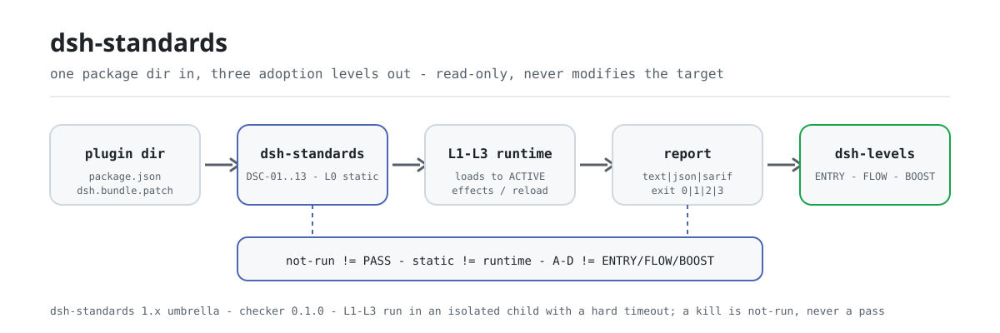

<div align="center">

<picture>
  <source media="(prefers-color-scheme: dark)" srcset="docs/assets/dsh-standards-flow-dark.svg">
  
</picture>

# dsh-standards

**एक ही कमांड में किसी DSH प्लगइन की अनुकूलता, उपयोग-सुविधा और दक्षता-साक्ष्य जानें — स्थिर कभी रनटाइम का रूप नहीं लेता, और `not-run` कभी PASS नहीं गिना जाता।**

DSH के तीन अपनाव-स्तरों (ENTRY / FLOW / BOOST) का निष्पादन-केंद्र: जाँचकर्ता, स्तर-ऑडिट और मानक पाठ यहीं रहते हैं; गद्य-मार्गदर्शिका [dsh-plugin-guide](https://github.com/PerryLink/dsh-plugin-guide) में है और निम्न-स्तरीय खंड-पाठ [dsh-plugin-spec](https://github.com/PerryLink/dsh-plugin-spec) में बना हुआ है।

[इंस्टॉल](#तीन-चरणों-में-शुरुआत) · [कॉन्फ़िगरेशन](#कॉन्फ़िगरेशन) · [FAQ](#faq) · [简体中文](README.md) · [English](README.en.md) · [Español](README.es.md) · [Português](README.pt.md) · [हिन्दी](README.hi.md)

[](LICENSE)
[](https://www.npmjs.com/package/dsh-standards)
[](#तीन-चरणों-में-शुरुआत)

[](https://github.com/PerryLink/dsh-standards/stargazers)
[](https://www.npmjs.com/package/dsh-standards)
[](https://gitee.com/perrylink/dsh-standards)

```sh
npm i -g dsh-standards                                        # ग्लोबल: dsh-standards + dsh-levels
npx dsh-standards <plugin-dir> --scope entry --entry-claim static   # या बिना इंस्टॉल किए चलाएँ
```

</div>

<sub>सामुदायिक परियोजना, DeepSeek से असंबद्ध: अनौपचारिक, प्रमाणन नहीं, सुरक्षा-ऑडिट नहीं, और कोई आधिकारिक समर्थन नहीं। `DeepSeek Harness` DeepSeek का ट्रेडमार्क है; यह परियोजना केवल `DSH` संक्षेप का उपयोग करती है। कैनोनिकल रिपॉज़िटरी: <https://github.com/PerryLink/dsh-standards> (Gitee एक मिरर है)।</sub>

## यह क्या है

यह रिपॉज़िटरी प्लगइन नहीं बनाती। यह मापने की लकीर बनाती है, और फिर उससे मापती है।

DSH अपनाव की गहराई के तीन स्तर हैं, हर स्तर का अपना प्रश्न और साक्ष्य-शब्दावली है, और वे **कभी एक अंक में नहीं मिलाए जाते**:

| स्तर | मानक / अभ्यास | कौन-सा प्रश्न | वर्तमान स्थिति |
|---|---|---|---|
| 1 | **DSH-ENTRY, संगतता आधार** | क्या मौजूदा प्लगइन को कोड बदले बिना पहचाना, इंस्टॉल और बूट किया जा सकता है? | 18/18 `recognized`; base-only 10/18 के पास रनटाइम साक्ष्य (8 clean + 2 reject); वास्तविक web प्रोफ़ाइल 16/18 बिना चेतावनी और 2 host-gate reject (स्व-आकलन, स्वतंत्र समीक्षा नहीं); client 15/15 loaded; 18/18 clean अभी नहीं |
| 2 | **DSH-FLOW, उपयोग की सहजता** | क्या उपयोगकर्ता बिना किसी अप्रत्याशित बात के इंस्टॉल, कॉन्फ़िगर, उपयोग, रिकवर, अपग्रेड और अनइंस्टॉल कर सकता है? | draft; fixture पर J1/J2/J4/J6 **12 PASS**; J3/J7 fixture runtime; J5/J8 static preflight; 10 वास्तविक पैकेज **78 PASS / 4 FAIL / 2 blocked / 66 not-run** |
| 3 | **DSH-BOOST, त्वरण** | क्या प्लगइन Cordis के मूल तत्वों (effect, inject, volatile, इवेंट, seam, job, सीमित समानांतरता) से विकास और उपयोग को मापने योग्य रूप से सस्ता बनाता है? | draft; LEV-1–8 **8/8 measured** (loader / context / provider-capture / synthetic timer; उत्पादन आधार-रेखा नहीं) |

यहाँ तीन चीज़ें हैं: `40-checker/` (DS-C जाँचकर्ता और सभी साक्ष्य-स्क्रिप्ट), `bin/` (दो सार्वजनिक प्रवेश बिंदु, `dsh-standards` और `dsh-levels`), और `spec/` के साथ संख्यांकित `31`–`35` दस्तावेज़ों का मानक पाठ। उपकरण लक्ष्य पैकेज को केवल पढ़ते हैं, उसे बदलते नहीं; निर्णय केवल साक्ष्य स्वीकार करता है, इसलिए `not-run`, `NA` और `static` कभी PASS के रूप में नहीं लिखे जाते।

npm पर पुराना आरक्षण `dsh-standards@0.0.3` केवल नाम रखता था; यह 1.x श्रृंखला उसकी जगह लेती है (अभी `1.1.2`), और दोनों bin `dsh-standards` तथा `dsh-levels` हैं।

स्थिर एंकर, `spec/levels.json` और हर रिपोर्ट में दर्ज: `repo=deepseek-ai/deepseek-harness`, `commit=ce7073d51254`, `dsh=0.2.2-alpha.2`, `cordis=4.0.6-alpha.1`। अलग रनटाइम संस्करण दें तो रिपोर्ट लिख देती है कि आपने किस लकीर से मापा।

### वर्तमान ठोस आँकड़े

- 18 पैकेज, entry static: **18/18 recognized, 0 clean**;
- 18 पैकेज, DS-C static: **0 PASS / 9 WARN / 9 FAIL**;
- 18 पैकेज, runtime base-only: **18/18 के पास कच्चा JSON; 10/18 G3 verified, 8 partial, 0 error**; host gate के बाद **8 clean + 2 reject + 8 partial**;
- client runtime: **15/15 `client-module-loaded`** (वास्तविक Chromium); web-app **4/4 loaded**;
- अनुपयोगी: **0 plugin code FAIL; 2 host-gate reject (telemetry/verification)**;
- जाँचकर्ता का स्व-परीक्षण: **128/128 tests** (स्थानीय रूप से `node --test 40-checker/test/*.test.mjs`; इसमें शासन, DCO, मूल्यांकन-रिकॉर्ड, घोषणा, सत्यापन, श्रृंखला और ड्रिफ़्ट परीक्षण शामिल हैं);
- J1: **6 PASS + 1 WARN**; LEV-3: volatile **0/20** बनाम control **20/20** remount; LEV-6: स्थिर prefix **100%** बनाम अस्थिर **0%**; LEV-7: **8.24×** (कृत्रिम, उत्पादन आधार-रेखा नहीं)।

ये आँकड़े स्व-आकलन और रिपॉज़िटरी की साक्ष्य-श्रृंखला हैं, तीसरे पक्ष की समीक्षा नहीं — रिपोर्ट का `notClaimed` फ़ील्ड ठीक-ठीक बताता है कि क्या दावा नहीं किया जा रहा (आधिकारिक मानक, प्रमाणन, सुरक्षा-ऑडिट, रैंकिंग, उत्पादन आधार-रेखा)।

<details>
<summary>रिपॉज़िटरी नक्शा (संख्यांकित 00–99 विनिर्देश चीनी में लिखे हैं)</summary>

- [START-HERE.md](START-HERE.md) — नए सत्र के लिए एक-पृष्ठ प्रवेश
- [docs/DEVELOPER-JOURNEY.md](docs/DEVELOPER-JOURNEY.md) — प्लगइन जीवनचक्र और उपकरण-श्रृंखला
- [spec/levels.json](spec/levels.json) — तीन स्तरों का मशीन-पठनीय सत्य-स्रोत
- [scheme/SCHEME-v1.md](scheme/SCHEME-v1.md) — A–E / A–D मूल्यांकन योजना और rubric
- [evidence/README.md](evidence/README.md) — केवल-जुड़ने वाली साक्ष्य-श्रृंखला और दोबारा चलाने के निर्देश
- [GOVERNANCE.md](GOVERNANCE.md) · [CONTRIBUTING.md](CONTRIBUTING.md) · [SECURITY.md](SECURITY.md) · [MODIFICATION-POLICY.md](MODIFICATION-POLICY.md)
- [RENAMES.md](RENAMES.md) — पुराने नाम से नई रिपॉज़िटरी का नक्शा
- [P0-P2-STATUS.md](P0-P2-STATUS.md) — मद-दर-मद DONE / PARTIAL / REPLACED

पूरा 51-दस्तावेज़ सूचकांक चीनी [README.md](README.md) में है।

</details>

## तीन चरणों में शुरुआत

**1. इंस्टॉल** (दो में से कोई भी; Node `>=24.9.0`):

```sh
# ग्लोबल इंस्टॉल: dsh-standards और dsh-levels दोनों PATH पर आ जाते हैं
npm i -g dsh-standards
# या बिना कुछ इंस्टॉल किए सीधे चलाएँ
npx dsh-standards --version
npx -p dsh-standards dsh-levels --help
```

कोई build चरण नहीं है: `bin/` और `40-checker/` ही प्रकाशित कलाकृति हैं। दूसरी npx कमांड में `-p dsh-standards` लिखना ज़रूरी है, क्योंकि npm पर नंगे नाम `dsh-levels` और `dsh-plugin-verify` दूसरी परियोजनाओं के हैं।

**2. एक जाँच चलाएँ** (लक्ष्य वह पैकेज डायरेक्टरी है जिसमें `package.json` हो):

```sh
# एंट्री अनुकूलता: स्थिर पहचान, रनटाइम का दावा नहीं
dsh-standards ./my-plugin --scope entry --entry-claim static

# पूरा DS-C (डिफ़ॉल्ट दायरा): JSON / SARIF 2.1.0 रिपोर्ट
dsh-standards ./my-plugin --format json --out report.json
dsh-standards ./my-plugin --format sarif --out report.sarif

# तीन-स्तरीय ऑडिट: ENTRY अपने आप चलता है; FLOW / BOOST साक्ष्य फ़ाइल के बिना not-run / not-measured रहते हैं
dsh-levels ./my-plugin --format json --out audit.json
```

**3. निर्णय पढ़ें** — पहले exit code, फिर `status`:

```text
0  completed, no FAIL (PASS or WARN; WARN does not claim a clean PASS)
1  completed, at least one FAIL
2  incomplete: a mandatory check did not run, or the checker itself failed
3  usage error
```

इस रिपॉज़िटरी के fixture पर वास्तविक आउटपुट (छोटा किया गया):

```text
scope=entry profile=package status=pass exit=0
level: DSH-ENTRY recognized
DSC-01  PASS  C-1    L0
DSC-14  NA    C-14   L1     entry static claim: no runtime evidence
coverage: mandatory=5 pass=5 warn=0 fail=0 na=0 notRun=0
```

उसी fixture पर `dsh-levels` तीनों स्तरों की स्थिति बताता है — `entry.state=recognized`, `flow.state=not-run`, `boost.state=not-measured` — और तीन `nextActions` पंक्तियाँ जोड़ता है कि आगे कौन-सा साक्ष्य चाहिए।

## मुख्य क्षमताएँ

- **स्थिर पक्ष (L0)**: लक्ष्य को चलाता नहीं; manifest, एंट्री, patch और स्रोत पढ़कर `DSC-01`–`DSC-03` और `DSC-10`–`DSC-13` तय करता है।
- **रनटाइम पक्ष (L1–L3)**: पैकेज को **पृथक चाइल्ड प्रोसेस** में Cordis रनटाइम पर लोड करता है और देखता है कि वह ACTIVE तक पहुँचता है या नहीं, घोषित `provide` वास्तव में रजिस्टर होता है या नहीं, effect टोपोलॉजी बनती है या नहीं, unload पर सब शून्य होता है या नहीं, और restart इडेम्पोटेंट है या नहीं। टाइमआउट का अर्थ है ज़बरदस्ती किल, और किल का अर्थ `not-run` है, कभी PASS नहीं।
- **रिपोर्ट पक्ष**: `text` / `json` / `sarif` (SARIF 2.1.0, GitHub code scanning के लिए तैयार); हर रिपोर्ट में `anchor` (harness commit, dsh और cordis संस्करण) होता है — संस्करण बदला तो लकीर भी बदल गई।
- **तीन-स्तरीय ऑडिट**: `dsh-levels` ENTRY के निर्णय को साक्ष्य-स्थिति में बदलता है और केवल J1–J8 (FLOW) तथा LEV-1–8 (BOOST) साक्ष्य फ़ाइलें पढ़ता है; साक्ष्य न हो तो `not-run` / `not-measured` बताता है।
- **केवल-पढ़ने वाला**: जाँचे जा रहे पैकेज को नहीं बदलता और लक्ष्य डायरेक्टरी में कुछ नहीं लिखता; रिपोर्ट stdout या `--out` पर जाती है।

### जाँचें

| ID | खंड | परत | क्या जाँचता है |
|---|---|---|---|
| `DSC-01` | C-1 | L0 | `manifest`, `name`, `version`, `license`, एंट्री, `dsh.bundle.patch`, export का रूप |
| `DSC-02` | C-2 | L0 | `engines.dsh` या `@deepseek-ai/dsh*` peer, जो runtime से संतुष्ट हो |
| `DSC-03` | C-3 | L0 | इंस्टॉल spec, मार्केट इंडेक्स प्रविष्टि, सप्लाई-चेन पिनिंग |
| `DSC-04` | C-4 | L1 | ACTIVE तक लोड होना |
| `DSC-05` | C-5 | L1 | घोषित `provide` वास्तव में रजिस्टर होना |
| `DSC-06` | C-6 | L1+L2 | effect टोपोलॉजी, निजी रजिस्ट्रेशन सतह |
| `DSC-07` | C-7 | L2 | unload के बाद effect / store / registry का शून्य पर लौटना |
| `DSC-08` | C-8 | L3 | restart की इडेम्पोटेंसी और ठंडा restart |
| `DSC-09` | C-9 | L1 | घोषित बनाम मापा गया का मिलान |
| `DSC-10` | C-10 | L0 | import के समय के साइड-इफ़ेक्ट (advisory, कभी FAIL नहीं) |
| `DSC-11` | C-11 | L0 | `dsh.capabilities` और उच्च-संकेत ट्रिगर |
| `DSC-12` | C-12 | L0 | क्रेडेंशियल backing file, `listRecords`, वैश्विक seam; साथ में `dsh.commitments` और `dsh.disclosure` का रूप भी पढ़ता है |
| `DSC-13` | C-13 | L0 | `dsh.labels`, `upstream`, निषिद्ध शब्दावली |

`--scope mvp` केवल 8 ID कवर करता है (`DSC-03/10/11/12/13` MVP से बाहर हैं) और `subset: "MVP-13"` के साथ `level: null` लिखता है — वह DS-C पास **नहीं** है।

### कौन-सा टूल, कब

| चरण | कमांड | टूल | आउटपुट |
|---|---|---|---|
| शुरुआत | `dsh-dev new` / `dsh-start new` | dsh-plugin-start | इंस्टॉल-योग्य ढाँचा |
| स्थिर पूर्व-जाँच | `dsh-dev check` / `dsh-ready` | dsh-plugin-ready | स्थिर रिपोर्ट (host `not-run`) |
| होस्ट अनुबंध | `dsh-clinic --only R,K,X` | dsh-plugin-doctor/clinic | होस्ट अनुबंध |
| पृथक इंस्टॉल | `dsh-test-drive` | dsh-test-drive | C3 साक्ष्य |
| मार्केट सबमिशन | `entry-validate --host-evidence` | इस रिपॉज़िटरी का `40-checker` | C1–C8 + C3 |
| टूल प्रबंधन | `dsh-tools list/doctor/install` | dsh-plugin-tools | संस्करण / इंस्टॉल मार्गदर्शन |

पूरा सफ़र [docs/DEVELOPER-JOURNEY.md](docs/DEVELOPER-JOURNEY.md) में, टूल परिवार [dsh-plugin-devtools](https://github.com/PerryLink/dsh-plugin-devtools) में, और पुराने नामों का नक्शा [RENAMES.md](RENAMES.md) में है।

## कॉन्फ़िगरेशन

कोई कॉन्फ़िग फ़ाइल नहीं है — हर सेटिंग कमांड-लाइन फ़्लैग है। दोनों कमांड के अपने सेट हैं: `dsh-standards <package-dir>` DS-C जाँचकर्ता को भेजता है (`--help` पूरा उपयोग छापता है) और `dsh-levels <package-dir>` तीन-स्तरीय ऑडिट को भेजता है।

असल में काम आने वाले आठ:

| फ़्लैग | डिफ़ॉल्ट | अर्थ |
|---|---|---|
| `<package-dir>` | `.` | लक्ष्य पैकेज डायरेक्टरी जिसमें `package.json` हो; tarball समर्थित नहीं |
| `--scope` | `ds-c` | `mvp` = 8 MVP ID; `ds-c` = पूरी घोषणा; `entry` = अनुकूलता द्वार |
| `--format` | `text` | `text` / `json` / `sarif` (SARIF 2.1.0) |
| `--entry-claim` | `runtime` | `runtime` को DSC-14 रनटाइम साक्ष्य चाहिए; `static` केवल संरचनात्मक पहचान का दावा |
| `--host` | — | app-boot का `lib/index.js`; bundle के G0–G3 smoke के लिए अनिवार्य |
| `--profile` | `package` | `package` / `listing` / `both`; `--market-index` दिए जाने पर `listing` |
| `--no-exec` | `false` | L1–L3 पूरी तरह छोड़ें, `not-run` के रूप में दर्ज (कभी PASS नहीं) |
| `--out` | — | रिपोर्ट stdout के बजाय फ़ाइल में लिखें |

<details>
<summary>पूरी फ़्लैग सूची (dsh-standards के सभी स्विच)</summary>

| फ़्लैग | डिफ़ॉल्ट | अर्थ |
|---|---|---|
| `--format` | `text` | रिपोर्ट प्रारूप: `text` / `json` / `sarif` |
| `--scope` | `ds-c` | जाँच दायरा: `mvp` / `ds-c` / `entry` |
| `--profile` | `package` | मूल्यांकन प्रोफ़ाइल: `package` / `listing` / `both` |
| `--runtime` | — | बने हुए `@deepseek-ai/cordis` के `lib/index.js` का पथ; L1–L3 चालू करता है |
| `--runtime-version` | `0.2.2-alpha.2` | anchor में दर्ज dsh रनटाइम संस्करण, C-2 के लिए |
| `--cordis-version` | `4.0.6-alpha.1` | anchor में दर्ज cordis संस्करण |
| `--commit` | `ce7073d51254` | anchor में दर्ज harness commit |
| `--install-spec` | — | C-3 के लिए सुझाया गया इंस्टॉल spec |
| `--market-index` | — | फ़ॉर्मैट-1 मार्केट इंडेक्स JSON; listing मोड चालू करता है |
| `--plugin-name` | — | मार्केट इंडेक्स के भीतर प्लगइन का नाम |
| `--timeout` | `10000` | L1–L3 टाइमआउट मि.से. (100–120000) |
| `--no-exec` | `false` | L1–L3 पूरी तरह छोड़ें, `not-run` / `NA` के रूप में दर्ज |
| `--static-only` | `false` | M1 मोड: केवल C-1/C-2/C-3/C-11/C-12/C-13 दायरे में, C-4–C-9 बाहर |
| `--treat-as-plugin` | `false` | bundle के सर्वर एंट्री पर L1–L3 चलाएँ |
| `--entry-runtime` | `require` | entry द्वार: पूरा G0–G3 या `server-entry` प्रॉक्सी |
| `--entry-claim` | `runtime` | entry द्वार: रनटाइम साक्ष्य (DSC-14) या केवल स्थिर पहचान |
| `--host` | — | app-boot का `lib/index.js`; bundle का G0–G3 smoke चालू करता है |
| `--base` | — | bundle smoke के लिए आधार `cordis.patch.yml` |
| `--web` | — | bundle smoke के लिए web-app का `cordis.patch.yml` |
| `--bare` | — | host farm के लिए bare-module आधार डायरेक्टरी |
| `--out` | — | रिपोर्ट stdout के बजाय फ़ाइल में लिखें |
| `--help` / `--version` | — | उपयोग छापें / `dsh-standards <संस्करण> (checker 0.1.0)` छापें |

`dsh-levels` के फ़्लैग:

| फ़्लैग | डिफ़ॉल्ट | अर्थ |
|---|---|---|
| `<package-dir>` | अनिवार्य | लक्ष्य पैकेज डायरेक्टरी जिसमें `package.json` हो |
| `--host` | — | ENTRY के लिए वास्तविक G0–G3 बूट |
| `--base` | — | bundle smoke के लिए आधार patch |
| `--bare` | — | bundle smoke के लिए bare-module farm |
| `--no-runtime` | `false` | `--host` दिए होने पर भी ENTRY स्थिर ही रहे |
| `--flow-evidence` | — | J1–J8 साक्ष्य JSON; हर प्रविष्टि का `status` `pass` / `fail` / `not-run` |
| `--boost-evidence` | — | LEV साक्ष्य JSON; केवल status वाली और साक्ष्य-कार्ड रहित पंक्ति `not-measured` में बदल जाती है |
| `--timeout` | `150000` | जाँचकर्ता टाइमआउट मि.से. |
| `--format` | `text` | `text` / `json` |
| `--out` | — | परिणाम फ़ाइल में लिखें |

</details>

## FAQ

<details>
<summary>क्या यह प्रमाणन या रैंकिंग है?</summary>

नहीं। परियोजना स्वयं को **अनौपचारिक, प्रमाणन नहीं, सुरक्षा-ऑडिट नहीं** कहती है और DeepSeek के समर्थन का प्रतिनिधित्व नहीं करती; कोई शुल्क नहीं, स्तर या रैंकिंग की बिक्री नहीं। `A–D` `scheme/` के गुणवत्ता ग्रेड हैं, जो `ENTRY` / `FLOW` / `BOOST` स्तरों से स्वतंत्र हैं — न रिपोर्ट और न दस्तावेज़ उन्हें एक अंक में मिलाते हैं। साक्ष्य चाहे कितना भी मज़बूत हो, वह स्व-आकलन और रिपॉज़िटरी की साक्ष्य-श्रृंखला है, और `notClaimed` फ़ील्ड हमेशा «आधिकारिक मानक / प्रमाणन / सुरक्षा-ऑडिट / रैंकिंग / उत्पादन आधार-रेखा» गिनाता है।

</details>

<details>
<summary>`18/18 recognized` और `18/18 clean` में क्या अंतर है?</summary>

`recognized` स्थिर पहचान का पास है (`--entry-claim static`, केवल संरचनात्मक घोषणा, रनटाइम का दावा नहीं)। `clean` को रनटाइम साक्ष्य चाहिए: base-only 10/18 के पास रनटाइम साक्ष्य (8 clean + 2 reject), वास्तविक web प्रोफ़ाइल 16/18 बिना चेतावनी और 2 host-gate reject, और यह सब स्व-आकलन है, स्वतंत्र समीक्षा नहीं — इसलिए **18/18 clean अभी भी हासिल नहीं** और कोई दस्तावेज़ इसके विपरीत नहीं कहता। इसी तरह, `client-module-loaded` न UI उपयोगिता है न प्रमाणन।

</details>

<details>
<summary>DSH रनटाइम न हो तो क्या होगा? क्या चुपचाप पास हो जाता है?</summary>

नहीं। L1–L3 को `--runtime` चाहिए (और bundle को `--host`); बिना उनके जाँचें `ERR` / `not-run` दर्ज होती हैं और कारण साथ लिखा जाता है (`no --runtime supplied; L1-L3 not run`), और package दायरे में निष्कर्ष `incomplete` होकर exit `2` देता है। `--scope entry --entry-claim static` अब भी `DSH-ENTRY recognized` देता है, पर वह स्थिर घोषणा है; रनटाइम निर्णय के लिए `--runtime` या `--host` दें।

</details>

<details>
<summary>क्या यह मेरे पैकेज को छूता है? क्या मेरा कोड टूट सकता है?</summary>

जाँचकर्ता लक्ष्य डायरेक्टरी को केवल पढ़ता है, उसे कभी नहीं बदलता। रनटाइम जाँच चलने पर लोडिंग एक **चाइल्ड प्रोसेस** में होती है और टाइमआउट पर ज़बरदस्ती किल होती है (डिफ़ॉल्ट 10 सेकंड, `--timeout` से बदलें); किल `not-run` दर्ज होती है, PASS नहीं, और चाइल्ड जाँचकर्ता का अपना environment नहीं पढ़ सकता। कुछ भी नहीं चलाना हो तो `--no-exec` जोड़ें, केवल स्थिर निर्णय चाहिए तो `--static-only`।

</details>

<details>
<summary>guide / doctor / cert / portal / catalog से इसका क्या संबंध है?</summary>

यह रिपॉज़िटरी मानक पाठ के साथ जाँचकर्ता और स्तर-ऑडिट है; गद्य-मार्गदर्शिका `dsh-plugin-guide` में है, होस्ट अनुबंध का मापन `dsh-plugin-doctor` (clinic) में, और मार्केट व पोर्टल उपकरण अलग हैं। भूमिकाओं का बँटवारा और योगदान के रास्ते चीनी दस्तावेज़ `39` में हैं, और ऊपर की चयन-तालिका संक्षेप में बताती है कि कब कौन-सा टूल लें।

</details>

## ज्ञात सीमाएँ

- **न प्रमाणन, न सुरक्षा-ऑडिट।** रिपोर्ट गुणवत्ता का संकेत है, अनुपालन का प्रमाण नहीं; `A–D` गुणवत्ता ग्रेड हैं, `ENTRY` / `FLOW` / `BOOST` नहीं।
- **कोई शुल्क नहीं, स्तरों की बिक्री नहीं, रैंकिंग की बिक्री नहीं।**
- **स्थिर को कभी रनटाइम के रूप में नहीं लिखा जाता।**
- **10/18 base-only को कभी 18/18 web/उत्पादन के रूप में नहीं लिखा जाता, और `client-module-loaded` को कभी UI या प्रमाणन के रूप में नहीं।**
- **आधिकारिक सिफ़ारिश या अपनाव, प्रमाणन, मान्यता या सुरक्षा-ऑडिट का दावा कभी नहीं।**
- **MVP कवरेज की कमी**: `--scope mvp` केवल 8 ID कवर करता है (`DSC-03/10/11/12/13` बाहर हैं); उसका निर्णय `subset: "MVP-13"` और `level: null` है और उसे DS-C बैज की तरह उपयोग नहीं करना चाहिए।
- **केवल पैकेज डायरेक्टरी**: लक्ष्य में `package.json` होना चाहिए; tarball समर्थन MVP का हिस्सा नहीं।
- **रनटाइम निर्णय की पूर्व-शर्तें**: `--runtime` या `--host` के बिना L1–L3 केवल `not-run` हो सकते हैं, और `--entry-claim static` कभी रनटाइम निर्णय नहीं देता।
- **निर्णय संस्करणों से बंधे हैं**: `commit` / `dsh` / `cordis` बदलें तो लकीर बदल जाती है; पुरानी रिपोर्ट नए संस्करण का साक्ष्य नहीं है।
- **BOOST के आँकड़े उत्पादन आधार-रेखा नहीं हैं**: LEV के 8/8 measured loader / context / provider-capture / synthetic timer वातावरण से आते हैं, और LEV-7 का 8.24× भी।
- **पाठ में बदलाव की घोषणा ज़रूरी**: इस रिपॉज़िटरी का पाठ कॉपी या बदलने पर स्पष्ट Change Notice देना होगा (स्रोत commit, कौन-सा खंड, क्या बदला, क्यों, तिथि), देखें [`MODIFICATION-POLICY.md`](MODIFICATION-POLICY.md); चिह्न और बैज ऊपर की लाइसेंसों से लाइसेंस नहीं होते, देखें `governance/mark-policy.md`।

## विकास

```sh
git clone https://github.com/PerryLink/dsh-standards.git
cd dsh-standards

node --test 40-checker/test/*.test.mjs                      # 128/128
node bin/dsh-standards.mjs 40-checker/fixtures/good \
  --scope entry --entry-claim static --format text          # fixture smoke
node bin/dsh-levels.mjs 40-checker/fixtures/good --format json

# सोर्स चेकआउट से सीधे जाँचकर्ता तक
node 40-checker/bin/dsh-plugin-verify.mjs <plugin-dir> --scope entry --entry-claim static
node 40-checker/bin/dsh-plugin-verify.mjs <bundle-dir> --scope entry \
  --host /path/to/@deepseek-ai/dsh-app-boot/lib/index.js

node 40-checker/scripts/journey-runtime.mjs --package <dir> --json   # J1 इंस्टॉल/अनइंस्टॉल सफ़र
node 40-checker/scripts/governance-check.mjs                # शासन खंड
node 40-checker/scripts/attestation-check.mjs               # मूल्यांकन रिकॉर्ड
node 40-checker/scripts/claim-check.mjs                     # घोषणा की निरंतरता
node 40-checker/scripts/dco-check.mjs --range HEAD~1..HEAD  # DCO
node publish/verify.mjs --id DSH-ATT-2026-001               # नमूना रिकॉर्ड सत्यापित करें

cd examples/boost && node lev7-bench.mjs 64 20              # LEV-7 सीमित-समानांतरता बेंचमार्क
```

README की छवियाँ [`scripts/gen-readme-assets.py`](scripts/gen-readme-assets.py) से कार्यक्रम-रूप में बनती हैं (Python + Pillow, हल्का और गहरा SVG) और कभी भी दोबारा बनाई जा सकती हैं: `python scripts/gen-readme-assets.py`.

### डायरेक्टरी संरचना

```text
00-99*.md         मानक / शोध / प्रोफ़ाइल / संचार दस्तावेज़
bin/              दो सार्वजनिक प्रवेश बिंदु: dsh-standards, dsh-levels
40-checker/       जाँचकर्ता, J1 सफ़र, bundle smoke, नमूने, परिणाम
governance/       भूमिकाएँ, योगदान शर्तें, चिह्न नीति, अपील, COI, निर्णय-लॉग
adoption/         official / market / developer अपनाव पैक
spec/             levels.json + clauses.json + schemas (evidence / report / attestation)
scheme/           A–E / A–D मूल्यांकन योजना और rubric
evidence/         केवल-जुड़ने वाली साक्ष्य-श्रृंखला और दोबारा चलाने के निर्देश
examples/boost/   LEV-7 संदर्भ कार्यान्वयन और बेंचमार्क
publish/          labels के उदाहरण + मूल्यांकन रिकॉर्ड JSON
docs/             DEVELOPER-JOURNEY जैसे दीर्घकालिक दस्तावेज़ और README की छवियाँ
```

### शासन और योगदान

- भूमिकाएँ और अनुमतियाँ: `governance/roles.json`; एक-पृष्ठ सारांश: [GOVERNANCE.md](GOVERNANCE.md)
- योगदान: DCO 1.1 + DCT v1 (`dsh-ct/1`, कॉपीराइट हस्तांतरण नहीं बल्कि लाइसेंस), देखें [CONTRIBUTING.md](CONTRIBUTING.md)
- चिह्न: `governance/mark-policy.md` (स्वतः प्रदान, रद्द करने योग्य, अस्वीकरण अनिवार्य)
- अपील: `governance/appeals.md`; AI केवल प्राप्ति, समय-गणना और समीक्षा करता है, अंतिम निर्णय मनुष्य का
- तीन अपनाव पैक: `adoption/{official,market,developer}/`

## परिवार और आभार

यह परियोजना [PerryLink](https://github.com/PerryLink) द्वारा संचालित DSH पारिस्थितिकी का एक सदस्य है: यह शाखा लकीर की है — मानक पाठ, जाँचकर्ता और स्तर-ऑडिट — जबकि मार्गदर्शिका, स्कैफ़ोल्डिंग, सत्यापन और पोर्टल उपकरणों की अपनी रिपॉज़िटरी हैं। अगर इसने आपको कुछ मैनुअल जाँचों से बचाया, तो **एक स्टार दें** — इससे कोई सुविधा नहीं खुलती, पर अगली बार प्लगइन जाँचने वाले को यह रिपॉज़िटरी खोजने में मदद मिलती है।

पहले का प्रोजेक्ट `dsh-plugin-standard` (lanbaolu) उसी पारिस्थितिकी का है और इस परियोजना से संबद्ध नहीं है; कोई भी उल्लेख या तुलना स्रोत बताएगी।

## लाइसेंस

- **पाठ / मानक / दस्तावेज़ / अनुवाद**: CC BY 4.0 ([`LICENSE-CC-BY`](LICENSE-CC-BY)); बदलावों के साथ [`MODIFICATION-POLICY.md`](MODIFICATION-POLICY.md) के अनुसार Change Notice अनिवार्य;
- **कोड / स्क्रिप्ट / schema**: Apache-2.0 ([`LICENSE-APACHE`](LICENSE-APACHE), पेटेंट अनुदान और रक्षात्मक समाप्ति सहित);
- **चिह्न / बैज**: अलग नियम `governance/mark-policy.md` में, ऊपर की लाइसेंसों से प्रदान नहीं;
- **योगदान**: DCO 1.1 + DCT v1, कॉपीराइट हस्तांतरण आवश्यक नहीं।

<p align="center"><sub>CC BY 4.0 (पाठ) · Apache-2.0 (कोड) · सामुदायिक परियोजना, DeepSeek से असंबद्ध।</sub></p>
