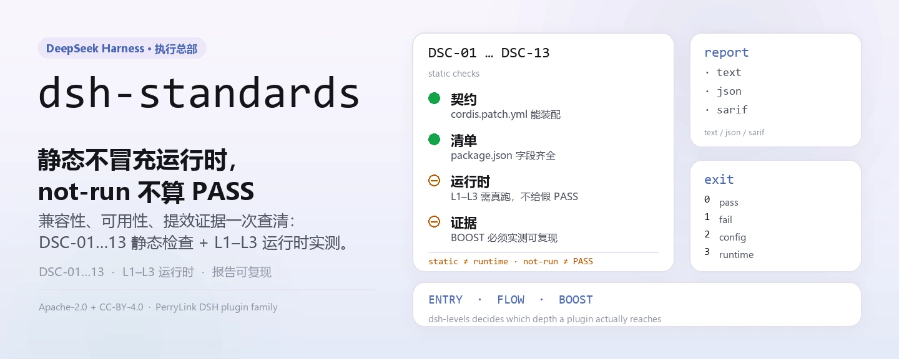
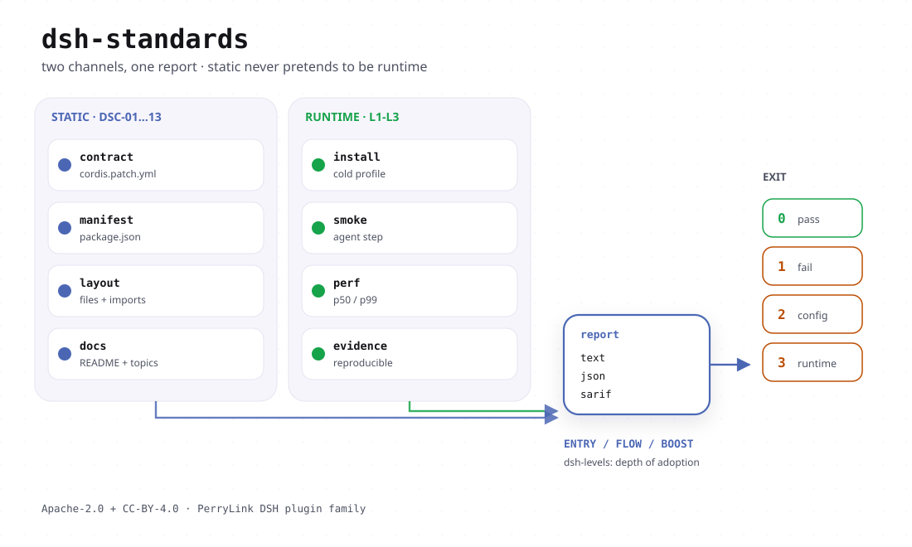

<div align="center">

<picture>
  <source media="(prefers-color-scheme: dark)" srcset="docs/assets/dsh-standards-hero-zh-dark.webp">
  
</picture>

# dsh-standards

**把 DSH 插件的兼容性、可用性与提效证据一次查清楚——静态不冒充运行时，`not-run` 不算 PASS。**

三层采用深度（ENTRY 入门 / FLOW 顺畅 / BOOST 加速）的执行总部：检查器、等级审计与规范正文都在这个仓；散文指南在 [dsh-plugin-guide](https://github.com/PerryLink/dsh-plugin-guide)，底层条款正文在 [dsh-plugin-spec](https://github.com/PerryLink/dsh-plugin-spec)。

[安装](#三步上手) · [配置](#配置) · [FAQ](#faq) · [简体中文](README.md) · [English](README.en.md) · [Español](README.es.md) · [Português](README.pt.md) · [हिन्दी](README.hi.md)

[](LICENSE)
[](https://www.npmjs.com/package/dsh-standards)
[](#三步上手)

[](https://github.com/PerryLink/dsh-standards/stargazers)
[](https://www.npmjs.com/package/dsh-standards)
[](https://gitee.com/perrylink/dsh-standards)

```sh
npm i -g dsh-standards                                        # 全局：dsh-standards + dsh-levels
npx dsh-standards check <plugin-dir>                          # 安全默认：静态检查，不执行插件代码
```

</div>

<sub>社区项目，与 DeepSeek 官方无关：非官方、非认证、非安全审计，不代表官方背书。`DeepSeek Harness` 是 DeepSeek 的商标，本项目只使用 `DSH` 缩写。唯一仓库：<https://github.com/PerryLink/dsh-standards>（Gitee 为镜像）。</sub>

## 它是什么

这个仓不写插件。它给插件定尺子，然后替你去量。

DSH 插件的采用深度分三层，每层一个问题、一套证据状态，**不合并成一个分数**：

| 层 | 规范/实践 | 回答什么问题 | 当前状态 |
|---|---|---|---|
| 1 | **DSH-ENTRY 入门规范** | 现有插件能否不改代码就被识别、安装、启动？ | 18/18 `recognized`；base-only 10/18 有 runtime 证据（8 clean + 2 reject）；real web profile 16/18 无告警、2 个 host-gate reject（自评，无独立复核）；client 15/15 loaded；18/18 clean 未达成 |
| 2 | **DSH-FLOW 顺畅规范** | 用户能否安装、配置、使用、恢复、升级、卸载而不出意外？ | draft；fixture 上 J1/J2/J4/J6 **12 PASS**；J3/J7 fixture runtime；J5/J8 static preflight；10 个真实包 **78 PASS / 4 FAIL / 2 blocked / 66 not-run** |
| 3 | **DSH-BOOST 加速实践** | 插件是否用 Cordis 原语（effect、inject、volatile、事件、seam、job、有界并行）让开发和使用可测量地更省？ | draft；LEV-1–8 **8/8 measured**（loader / context / provider-capture / synthetic timer；非生产基线） |

### 上游与使用（事实，2026-11）

- **dsh-plugin-hub** —— 版本感知的 npm 元数据校验已合入 main（[`4f3a560`](https://github.com/dshplugin/dsh-plugin-hub/commit/4f3a560)，2026-11-09）。范围仅安装侧的 npm 元数据（包/版本存在性、`repository` 回链）；不运行 ENTRY，也不构成对任何插件的背书。
- **使用量**（npm registry，2026-11）：`dsh-plugin-guide` ≈12.6k/月、`dsh-standards` ≈4.4k/月、`dsh-plugin-start` ≈1.65k/月。下载量不是独立用户数，也不构成排名、认证或安全结论。
- **工具链**：`dsh-plugin-guide`（指南 / skill）、`dsh-plugin-start`（生成器，产物自带检查与 advisory CI）、`dsh-check-action`（只读 ENTRY 的 Action）、`dsh-plugin-spec`（条款原文）、`dsh-primer`（旧版开发 skill / CLI）。

仓里就三样东西：`40-checker/`（DS-C 一致性检查器与全部证据脚本）、`bin/`（两个公开入口 `dsh-standards` 与 `dsh-levels`），以及 `spec/` 与 `31`–`35` 号规范正文。工具只读目标包，不改被检对象；结论只认证据，`not-run`、`NA`、`static` 都不会被写成 PASS。

npm 上的旧占位 `dsh-standards@0.0.3` 只是名字预留，这条 1.x 线取代了它（当前 `1.6.12`）；两个 bin 分别叫 `dsh-standards` 与 `dsh-levels`。

锚点不是硬编码的通行证：`repo` / `commit` / `cordis` 记在报告里，`dsh` 由 `--host-version`、`DSH_HOST_VERSION` 或显式 `--allow-host-probe` 解析；都没有时报告写「host 版本未知」，并标 `source=default, suspect=true`。换一次版本就是另一把尺子，旧报告不能直接当新版本的证据。

### 当前硬数据

- 18 包 entry static：**18/18 recognized，0 clean**；
- 18 包 DS-C static：**0 PASS / 9 WARN / 9 FAIL**；
- 18 包 base-only runtime：**18/18 有原始 JSON；10/18 G3 verified，8 partial，0 error**；host gate 后 **8 clean + 2 reject + 8 partial**；
- client runtime：**15/15 `client-module-loaded`**（真实 Chromium）；web-app **4/4 loaded**；
- 不可用：**0 plugin code FAIL；2 host-gate reject（telemetry/verification）**；
- 检查器自测：**`npm test` 全绿**（本地 Node 24；含安全默认、host 三态、治理、DCO、评价记录、声明、验真、链、漂移测试）；
- J1：**6 PASS + 1 WARN**；LEV-3：volatile **0/20** vs control **20/20** remount；LEV-6：稳定 prefix **100%** vs 易变 **0%**；LEV-7：**8.24×**（合成，非生产基线）。

这些数字是自评与仓内证据链的输出，不是第三方复核结论——报告里的 `notClaimed` 字段会把「官方标准、认证、安全审计、排名、生产基线」逐条列出来。

<details>
<summary>文档地图：新会话从这里进（51 篇规范 / 研究 / 画像 / 沟通包）</summary>

- [START-HERE](START-HERE.md) — 新会话先读的一页入口
- [51-新会话操作手册](51-新会话操作手册.md) — 仓库地图、命令、权限、常见坑
- [00-索引](00-索引.md) — 全包路由
- [31-DSH-ENTRY 入门规范](31-DSH-ENTRY入门规范.md) — 内部条款
- [99-DSH-ENTRY 兼容性画像（对外版）](99-DSH-ENTRY兼容性画像-对外版.md) — 4–6 页对外版
- [32-DSH-FLOW 顺畅规范](32-DSH-FLOW顺畅规范.md) — J1–J8
- [33-DSH-BOOST 加速实践](33-DSH-BOOST加速实践.md) — 8 条 LEV
- [34-三层分级模型（GB/GB-T/GB-Z 类比）](34-三层分级模型-GB-GBT-GBZ类比.md) — 为什么是三层、怎么读
- [35-三层开发建议与验收清单](35-三层开发建议与验收清单.md) — 作者最短路径 / 评审清单
- [docs/coverage.md](docs/coverage.md) — 14 项检查：默认查什么、不查什么、怎么开启
- [36-插件全生命周期与工具链](36-插件全生命周期与工具链.md) — 从脚手架到退役
- [37-PerryLink 插件生态三层对照](37-PerryLink插件生态-三层对照与升级清单.md) — 我的仓怎么升级
- [38-三层标准 RFC](38-RFC-三层标准-待商议问题.md) — 内测群商议的 8 个问题
- [39-五工具定位与贡献](39-五工具定位与贡献.md) — guide/doctor/cert/portal/catalog 的角色
- [40-五工具全面转向方案](40-五工具全面转向方案.md) — 以三层为主轴的迁移计划
- [42-标准体系缺口](42-标准体系缺口-认证检验认可.md) — 认证/检验/认可/监督还差什么
- [43-缺口总账与 AI 可执行方案](43-缺口总账与AI可执行方案.md) — 全部缺口、AI/Human/模板/删除裁决、90 天 P0–P3
- [44-角色治理与贡献机制](44-角色治理与贡献机制.md) — 角色阶梯、DCO+DCT（CLA 式）、COI、申诉、AI 职员
- [45-三用途落地](45-三用途落地-官方市场开发者.md) — 官方前沿探索 / 市场参考 / 开发者指南
- [P0-P2 执行状态](P0-P2-STATUS.md) — 逐项 DONE / PARTIAL / REPLACED
- [46-剩余事项与执行建议](46-剩余事项与执行建议.md) — 还差什么、先做什么、什么不做
- [47-配套插件发布记录](47-配套插件发布记录-2026-11-02.md) — guide/doctor/kit/upgrade/cert-mcp 的 npm + Release
- [48-配套包命名研究](48-配套包命名研究-2026-11-02.md) — `dsh-*` 占用情况与命名备选
- [49-配套包改名迁移记录](49-配套包改名迁移记录-2026-11-02.md) — clinic / scaffold / primer / codemod 的新旧仓映射、指针与 deprecate
- [50-新会话交接提示词](50-新会话交接提示词.md) — 无上下文新会话的启动提示词
- [scheme/](scheme/SCHEME-v1.md) — A–E / A–D 评价方案与 rubric
- [evidence/](evidence/README.md) — 追加式证据链与复跑说明
- [97-采纳可行性评估](97-采纳可行性评估.md) — 官方路径、缺口、90 天
- [98-内测群与官方沟通包](98-内测群与官方沟通包.md) — 对外话术

</details>

<picture>
  <source media="(prefers-color-scheme: dark)" srcset="docs/assets/dsh-standards-flow-v4-dark.svg">
  
</picture>

## 三步上手

**1. 安装**（二选一，Node 需 `>=24.9.0`）：

```sh
# npm 全局安装：之后 dsh-standards 与 dsh-levels 都在 PATH 上
npm i -g dsh-standards
# 或者完全不装，直接用 npx 跑
npx dsh-standards --version
npx -p dsh-standards dsh-levels --help
```

没有构建步骤：`bin/` 与 `40-checker/` 就是发布产物。npx 第二个命令要写成 `-p dsh-standards`，因为 npm 上的 `dsh-levels` 与 `dsh-plugin-verify` 这两个裸名属于其他项目。

**2. 跑一次检查**（目标是一个含 `package.json` 的包目录）：

```sh
# 作者入口（推荐）：默认 --entry-claim static --no-exec，不执行插件代码
dsh-standards check ./my-plugin

# 入门兼容性：静态识别，不声明运行时证据
dsh-standards ./my-plugin --scope entry --entry-claim static

# DS-C 全量（默认 ds-c）：JSON / SARIF 2.1.0 报告
dsh-standards ./my-plugin --format json --out report.json
dsh-standards ./my-plugin --format sarif --out report.sarif

# 三层自检：ENTRY 自动跑；FLOW / BOOST 没证据文件就如实记 not-run / not-measured
dsh-levels ./my-plugin --format json --out audit.json
```

`check` 是面向作者的安全入口：**默认 `--entry-claim static --no-exec`，不执行插件代码**；Markdown 报告顶部会写明「本次未执行插件代码」。要跑 L1–L3，必须显式给 `--runtime <cordis lib/index.js>`（bundle 用 `--host`）或 `--entry-claim runtime`，否则运行时项一律记 `not-run`，绝不写成 PASS。它也不会无条件执行 PATH 里的 `dsh`：anchor 依次取 `--host-version`、`$DSH_HOST_VERSION`，再次才是显式 `--allow-host-probe`；三者都没有时报告写「host 版本未知」，并标 `source=default, suspect=true`。

**3. 看结论**——先看 exit code，再看 `status`：

```text
0  completed, no FAIL (PASS or WARN; WARN does not claim a clean PASS)
1  completed, at least one FAIL
2  incomplete: a mandatory check did not run, or the checker itself failed
3  usage error
```

本仓 fixture 上的真实输出（缩略）：

```text
scope=entry profile=package status=pass exit=0
level: DSH-ENTRY recognized
DSC-01  PASS  C-1    L0
DSC-14  NA    C-14   L1     entry static claim: no runtime evidence
coverage: mandatory=5 pass=5 warn=0 fail=0 na=0 notRun=0
```

`dsh-levels` 在同一个 fixture 上给出三层状态：`entry.state=recognized`、`flow.state=not-run`、`boost.state=not-measured`，并附三条 `nextActions` 告诉你下一步该补什么证据。

## 核心能力

- **静态面（L0）**：不执行目标代码，只读 manifest、入口、patch 与源码，判 `DSC-01`–`DSC-03`、`DSC-10`–`DSC-13`。
- **运行时面（L1–L3）**：在**隔离子进程**里把包装载到 Cordis 运行时，看它是否 ACTIVE、声明的 `provide` 是否真注册、effect 是否成拓扑、卸载是否归零、restart 是否幂等；超时硬杀，被杀记 `not-run`，绝不记 PASS。
- **报告面**：`text` / `json` / `sarif`（SARIF 2.1.0，可进 GitHub code scanning）；报告带 `anchor`（harness commit、dsh、cordis 版本），换一次版本就是另一把尺子。
- **三层审计**：`dsh-levels` 把 ENTRY 的检查器结论映射成证据状态，并对 FLOW 的 J1–J8、BOOST 的 LEV-1–8 只读证据文件——没有证据就报 `not-run` / `not-measured`。
- **只读**：不修改被检包、不往目标目录写文件；报告只走 stdout 或 `--out` 指定的路径。

### 检查项

| ID | 条款 | 层 | 说明 |
|---|---|---|---|
| `DSC-01` | C-1 | L0 | `manifest`、`name`、`version`、`license`、入口、`dsh.bundle.patch`、导出形态 |
| `DSC-02` | C-2 | L0 | `engines.dsh` 或 `@deepseek-ai/dsh*` peer，被 runtime 满足 |
| `DSC-03` | C-3 | L0 | 安装 spec、市场索引条目、供应链固定性 |
| `DSC-04` | C-4 | L1 | 装载到 ACTIVE |
| `DSC-05` | C-5 | L1 | 声明的 `provide` 真实注册 |
| `DSC-06` | C-6 | L1+L2 | effect 拓扑、私有注册面 |
| `DSC-07` | C-7 | L2 | 卸载后 effect / store / registry 归零 |
| `DSC-08` | C-8 | L3 | restart 幂等 + 冷重启 |
| `DSC-09` | C-9 | L1 | 声明 vs 实测交叉 |
| `DSC-10` | C-10 | L0 | import 期副作用（advisory，不 FAIL） |
| `DSC-11` | C-11 | L0 | `dsh.capabilities` + 高信号触发 |
| `DSC-12` | C-12 | L0 | 凭据 backing file、`listRecords`、全局 seam；并读取 `dsh.commitments` 与 `dsh.disclosure` 的形状 |
| `DSC-13` | C-13 | L0 | `dsh.labels`、`upstream`、禁用语标签 |

`--scope mvp` 只落到 8 个 ID（`DSC-03/10/11/12/13` 不在 MVP），结论写 `subset: "MVP-13"`、`level: null`——**不是** DS-C 通过。

### 什么时候用哪个工具

| 阶段 | 命令 | 工具 | 产出 |
|---|---|---|---|
| 开始 | `dsh-dev new` / `dsh-start new` | dsh-plugin-start | 可安装骨架 |
| 静态预检 | `dsh-dev check` / `dsh-ready` | dsh-plugin-ready | static report（host `not-run`） |
| 宿主契约 | `dsh-clinic --only R,K,X` | dsh-plugin-doctor/clinic | 宿主契约 |
| 隔离安装 | `dsh-test-drive` | dsh-test-drive | C3 证据 |
| 市场提交 | `entry-validate --host-evidence` | 本仓 `40-checker` | C1–C8 + C3 |
| 工具管理 | `dsh-tools list/doctor/install` | dsh-plugin-tools | 版本 / 安装指引 |

完整旅程见 [docs/DEVELOPER-JOURNEY.md](docs/DEVELOPER-JOURNEY.md)，工具家族见 [dsh-plugin-devtools](https://github.com/PerryLink/dsh-plugin-devtools)，旧名项目见 [RENAMES.md](RENAMES.md)。

## 配置

没有配置文件——全部可调项就是命令行参数。三个入口各一套：`dsh-standards check <package-dir>` 是作者安全入口（默认静态、不执行插件代码），`dsh-standards <package-dir>` 是向后兼容的裸检查器（不附加安全默认，`--help` 打印完整用法），`dsh-levels <package-dir>` 转发给三层审计。下表默认值指 `check`；裸检查器的 `--entry-claim` / `--no-exec` 默认仍是 `runtime` / `false`。

最常用的 10 个：

| 参数 | 默认值 | 含义 |
|---|---|---|
| `<package-dir>` | `.` | 目标包目录，必须含 `package.json`；tarball 不在支持范围 |
| `--scope` | `ds-c` | `mvp` = 8 个 MVP ID；`ds-c` = 全量声明；`entry` = 兼容性门 |
| `--format` | `text` | `text` / `json` / `sarif`（SARIF 2.1.0） |
| `--entry-claim` | `static`（`check`；裸检查器 `runtime`） | `runtime` 需 DSC-14 运行时证据；`static` 只声明结构识别 |
| `--host` | — | app-boot 的 `lib/index.js`；bundle 的 G0–G3 冒烟必需，也视为执行 opt-in |
| `--profile` | `package` | `package` / `listing` / `both`；给了 `--market-index` 时默认 `listing` |
| `--no-exec` | `true`（`check`；裸检查器 `false`） | 跳过 L1–L3，记 `not-run`（绝不记 PASS） |
| `--host-version` | `$DSH_HOST_VERSION` | `check` 专用的宿主 dsh 版本；不执行任何 `dsh` |
| `--allow-host-probe` | `false` | 显式允许 `check` 解析 `dsh` 的 JS 入口并 `node ... --version` 探测 |
| `--out` | — | 报告写入文件；不给就打 stdout |

<details>
<summary>完整参数表（dsh-standards 的全部开关）</summary>

| 参数 | 默认值 | 含义 |
|---|---|---|
| `--format` | `text` | 报告格式：`text` / `json` / `sarif` |
| `--scope` | `ds-c` | 检查范围：`mvp` / `ds-c` / `entry` |
| `--profile` | `package` | 评估 profile：`package` / `listing` / `both` |
| `--runtime` | — | 指向构建好的 `@deepseek-ai/cordis` `lib/index.js`，开启 L1–L3 |
| `--runtime-version` | 宿主版本（`check`）；否则内置常量 | 写进 anchor 的 dsh 运行时版本，供 C-2 判定；报告用 `anchor.runtimeSource` 说明来源 |
| `--cordis-version` | `4.1.0` | 写进 anchor 的 cordis 版本 |
| `--commit` | `38a6a5c965aa` | 写进 anchor 的 harness commit |
| `--install-spec` | — | 给 C-3 用的推荐安装 spec |
| `--market-index` | — | 格式 1 的市场索引 JSON，开启 listing 模式 |
| `--plugin-name` | — | 市场索引里的插件名 |
| `--timeout` | `10000` | L1–L3 超时毫秒（100–120000） |
| `--no-exec` | `false`（裸检查器；`check` 默认 `true`） | 完全跳过 L1–L3，记 `not-run` / `NA` |
| `--static-only` | `false` | M1 模式：只留 C-1/C-2/C-3/C-11/C-12/C-13，C-4–C-9 直接出界 |
| `--treat-as-plugin` | `false` | 对 bundle 的 server 入口跑 L1–L3 |
| `--entry-runtime` | `require` | entry 门要完整 G0–G3，还是接受 `server-entry` 代理 |
| `--entry-claim` | `runtime`（裸检查器；`check` 默认 `static`） | entry 门要运行时证据（DSC-14），还是只做静态识别 |
| `--host` | — | app-boot `lib/index.js`，开启 bundle 的 G0–G3 冒烟（`check` 中视为执行 opt-in） |
| `--host-version` | `$DSH_HOST_VERSION` | `check` 专用：直接声明宿主版本，不执行 `dsh` |
| `--allow-host-probe` | `false` | `check` 专用：显式允许探测宿主版本 |
| `--base` | — | bundle 冒烟用的 base `cordis.patch.yml` |
| `--web` | — | bundle 冒烟用的 web-app `cordis.patch.yml` |
| `--bare` | — | host farm 的 bare-module 基线目录 |
| `--out` | — | 报告写入文件，否则 stdout |
| `--help` / `--version` | — | 打印用法 / 打印 `dsh-standards <版本> (checker 0.1.0)` |

`dsh-levels` 的参数：

| 参数 | 默认值 | 含义 |
|---|---|---|
| `<package-dir>` | 必填 | 目标包目录，必须有 `package.json` |
| `--host` | — | 给 ENTRY 用：真实 G0–G3 启动 |
| `--base` | — | bundle 冒烟的 base patch |
| `--bare` | — | bundle 冒烟的 bare-module farm |
| `--no-runtime` | `false` | 即使给了 `--host` 也只做静态 ENTRY |
| `--flow-evidence` | — | J1–J8 证据 JSON：每项 `status` 取 `pass` / `fail` / `not-run` |
| `--boost-evidence` | — | LEV 证据 JSON；只有 `status` 没有证据卡的条目降级为 `not-measured` |
| `--timeout` | `150000` | 检查器超时毫秒 |
| `--format` | `text` | `text` / `json` |
| `--out` | — | 结果写入文件 |

</details>

## FAQ

<details>
<summary>这是认证或排名吗？</summary>

不是。本仓自我定位就是**非官方、非认证、非安全审计**，不代表 DeepSeek 官方背书；不收费、不卖等级、不卖排名。`A–D` 是 `scheme/` 里的质量评价等级，与 `ENTRY` / `FLOW` / `BOOST` 三层正交——报告与文档都不把两者混成一个分数。证据再硬，也只是自评加仓内证据链，`notClaimed` 字段固定列出「官方标准 / 认证 / 安全审计 / 排名 / 生产基线」。

</details>

<details>
<summary>`18/18 recognized` 和 `18/18 clean` 差在哪？</summary>

`recognized` 是静态识别通过（`--entry-claim static`，只声明结构，不声明运行）。`clean` 需要运行时证据：base-only 10/18 有 runtime 证据（8 clean + 2 reject），real web profile 16/18 无告警、2 个是 host-gate reject，而且这些是自评、没有独立复核——所以 **18/18 clean 仍未达成**，文档里也不会写成达成。同理，`client-module-loaded` 不等于 UI 可用，更不等于认证。

</details>

<details>
<summary>不装 DSH 运行时会怎样？会静默通过吗？</summary>

不会。L1–L3 需要 `--runtime`（bundle 还需要 `--host`）；缺了就记 `ERR` / `not-run`，原因直接写在报告里（`no --runtime supplied; L1-L3 not run`），在 package 范围下结论变 `incomplete`、exit `2`。`--scope entry --entry-claim static` 仍然能给出 `DSH-ENTRY recognized`，但那是静态声明；要运行时结论就传 `--runtime` 或 `--host`。

</details>

<details>
<summary>它会动我的包吗？会不会把我的代码跑坏？</summary>

检查器只读目标目录，不修改被检对象。要跑运行时检查时，它把装载过程放进**子进程**，超时（默认 10s，可用 `--timeout` 调）就硬杀，被杀记 `not-run` 而不是 PASS；子进程也读不到检查器自己的环境。完全不想执行目标代码就加 `--no-exec`，只要静态结论就加 `--static-only`。

</details>

<details>
<summary>和 guide / doctor / cert / portal / catalog 是什么关系？</summary>

本仓是「规范正文 + 检查器 + 等级审计」；散文式指南在 `dsh-plugin-guide`，宿主契约实测在 `dsh-plugin-doctor`（clinic），市场与门户工具各自独立。五者的角色划分与贡献方式在 [39-五工具定位与贡献](39-五工具定位与贡献.md)，工具选型表见上面的「什么时候用哪个工具」。

</details>

## 已知限制

- **不做认证，也不做安全审计。** 报告是质量信号，不是合规证明；`A–D` 是质量等级，不是 `ENTRY` / `FLOW` / `BOOST`。
- **不收费、不卖等级、不卖排名。**
- **不把 static 写成 runtime。**
- **不把 10/18 base-only 写成 18/18 web/生产；不把 `client-module-loaded` 写成 UI/认证。**
- **不声称官方推荐或采纳；不声称认证 / 认可 / 安全审计。**
- **MVP 覆盖缺口**：`--scope mvp` 只落 8 个 ID，`DSC-03/10/11/12/13` 不在其中；它的结论是 `subset: "MVP-13"`、`level: null`，不得当 DS-C 徽章用。
- **只吃包目录**：目标必须是含 `package.json` 的目录；tarball 支持不在 MVP 里。
- **运行时结论有前置条件**：没有 `--runtime` 或 `--host` 时 L1–L3 只能记 `not-run`；`--entry-claim static` 永远给不出运行时结论。`check` 默认就是不执行（`--no-exec`），这是刻意的安全默认，不是缺陷。
- **host 版本可能未知**：`check` 不无条件执行 PATH 里的 `dsh`；没有 `--host-version` / `DSH_HOST_VERSION` / `--allow-host-probe` 时，anchor 写默认常量并标 `source=default, suspect=true`，报告顶部写「host 版本未知」。
- **结论带版本锚点**：`commit` / `dsh` / `cordis` 变了就是另一把尺子，旧报告不能直接当新版本的证据。
- **BOOST 数据不是生产基线**：LEV 的 8/8 measured 来自 loader / context / provider-capture / synthetic timer 的合成环境，LEV-7 的 8.24× 同理。
- **文本改动必须说明**：复制或修改本仓文本时，必须在显著位置给出 Change Notice（来源 commit、改了哪个章节、改了什么、为什么、日期），见 [`MODIFICATION-POLICY.md`](MODIFICATION-POLICY.md)；标志与 badge 不随许可证授权，规则见 `governance/mark-policy.md`。

## 开发

```sh
git clone https://github.com/PerryLink/dsh-standards.git
cd dsh-standards

node --test 40-checker/test/*.test.mjs                      # 全绿（含安全默认与 host 三态）
node bin/dsh-standards.mjs check 40-checker/fixtures/good   # 安全默认：静态、不执行
node bin/dsh-standards.mjs 40-checker/fixtures/good \
  --scope entry --entry-claim static --format text          # 裸检查器 fixture 冒烟
node bin/dsh-levels.mjs 40-checker/fixtures/good --format json

# 从源码直连检查器：结构识别 / 声明运行（bundle 需要 host）
node 40-checker/bin/dsh-plugin-verify.mjs <plugin-dir> --scope entry --entry-claim static
node 40-checker/bin/dsh-plugin-verify.mjs <bundle-dir> --scope entry \
  --host /path/to/@deepseek-ai/dsh-app-boot/lib/index.js

node 40-checker/scripts/journey-runtime.mjs --package <dir> --json   # J1 安装/卸载旅程
node 40-checker/scripts/governance-check.mjs                # 治理条款
node 40-checker/scripts/attestation-check.mjs               # 评价记录
node 40-checker/scripts/claim-check.mjs                     # 声明一致性
node 40-checker/scripts/dco-check.mjs --range HEAD~1..HEAD  # DCO
node publish/verify.mjs --id DSH-ATT-2026-001               # 验真示例记录

cd examples/boost && node lev7-bench.mjs 64 20              # LEV-7 有界并行基准
```

配图由 [`scripts/gen-readme-assets.py`](scripts/gen-readme-assets.py) 程序化生成（Python + Pillow，深色 / 浅色双版 SVG），可重复执行：`python scripts/gen-readme-assets.py`。

### 目录

```text
00-99*.md         规范/研究/画像/沟通包
bin/              两个公开入口：dsh-standards、dsh-levels
40-checker/       检查器、J1 旅程、bundle smoke、样本框、结果
governance/       角色/贡献条款/标志/申诉/COI/决策日志 + 机器检查
adoption/         official / market / developer 三套采用包
spec/             levels.json + clauses.json + schemas（evidence / report / attestation）
scheme/           A–E / A–D 评价方案与 rubric
evidence/         追加式证据链与复跑说明
examples/boost/   LEV-7 参考实现与基准
publish/          labels 示例 + 评价记录 JSON
docs/             DEVELOPER-JOURNEY 等长期文档与 README 配图
```

### 治理与贡献

- 角色与权限：`governance/roles.json`；一页说明：[GOVERNANCE.md](GOVERNANCE.md)
- 贡献：DCO 1.1 + DCT v1（`dsh-ct/1`，许可而非版权转让），见 [CONTRIBUTING.md](CONTRIBUTING.md)
- 标志：`governance/mark-policy.md`（自动授予、可撤销、必须带免责声明）
- 申诉：`governance/appeals.md`；AI 只受理 / 计时 / 复核，人类终裁
- 三用途采用包：`adoption/{official,market,developer}/`（按 `45` 落地）

## 家族与致谢

本项目是 [PerryLink](https://github.com/PerryLink) 维护的 DSH 生态项目之一：这一支负责「尺子」——规范正文、检查器与等级审计；指南、脚手架、检验与门户工具各有独立仓库。如果它帮你省下了几次手工核对，**给个 star**——它不解锁任何功能，但会让下一个要核对插件的人更容易找到这里。

同生态的先行项目 `dsh-plugin-standard`（lanbaolu）与本项目无隶属关系，引用或对比时都会标注来源。

## License

- **文本 / 规范 / 文档 / 翻译**：CC BY 4.0（[`LICENSE-CC-BY`](LICENSE-CC-BY)）；修改必须按 [`MODIFICATION-POLICY.md`](MODIFICATION-POLICY.md) 给出 Change Notice；
- **代码 / 脚本 / schema**：Apache-2.0（[`LICENSE-APACHE`](LICENSE-APACHE)，含专利授权与防御终止）；
- **标志 / badge**：单独规则，见 `governance/mark-policy.md`，不随上述许可授权；
- **贡献**：DCO 1.1 + DCT v1，不要求版权转让。

<p align="center"><sub>CC BY 4.0（文本）· Apache-2.0（代码）· 社区项目，与 DeepSeek 无关。</sub></p>


## 相关：HCB（兼容 × 三轨）

[HCB v0.2](https://github.com/PerryLink/dsh-compat-baseline) 消费 `dsh-levels/1`：把 `engines.dsh` 映射到最近 10 个 DSH host，并把 `dsh.standards` 里的 ENTRY/FLOW/BOOST 三轨原样展示，另加 capability risk 与 `hcb-gate/1` 门禁建议。它**不把三轨压成分数**，也不替代 dsh-standards 的检查：HCB 回答「声明了什么」，dsh-standards 回答「实际是否通过」。
