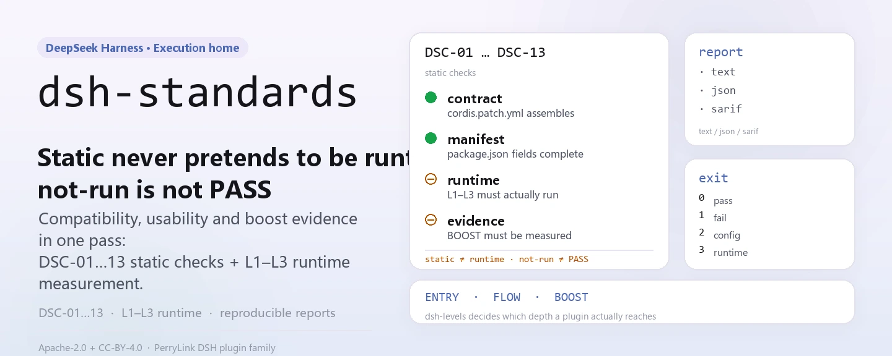
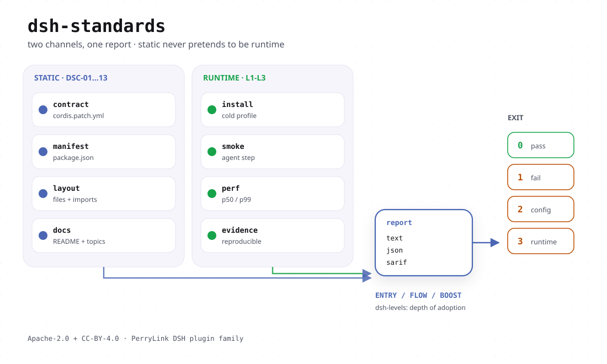

<div align="center">

<picture>
  <source media="(prefers-color-scheme: dark)" srcset="docs/assets/dsh-standards-hero-en-dark.webp">
  
</picture>

# dsh-standards

**Descubra em um único comando a compatibilidade, a usabilidade e a evidência de eficiência de um plugin DSH — o estático nunca se disfarça de runtime e `not-run` nunca conta como PASS.**

A sede de execução dos três níveis de adoção do DSH (ENTRY / FLOW / BOOST): o verificador, a auditoria de níveis e o texto normativo ficam aqui; o guia em prosa está em [dsh-plugin-guide](https://github.com/PerryLink/dsh-plugin-guide) e o texto das cláusulas de baixo nível continua em [dsh-plugin-spec](https://github.com/PerryLink/dsh-plugin-spec).

[Instalar](#instalação-em-três-passos) · [Configuração](#configuração) · [FAQ](#faq) · [简体中文](README.md) · [English](README.en.md) · [Español](README.es.md) · [Português](README.pt.md) · [हिन्दी](README.hi.md)

[](LICENSE)
[](https://www.npmjs.com/package/dsh-standards)
[](#instalação-em-três-passos)

[](https://github.com/PerryLink/dsh-standards/stargazers)
[](https://www.npmjs.com/package/dsh-standards)
[](https://gitee.com/perrylink/dsh-standards)

```sh
npm i -g dsh-standards                                        # global: dsh-standards + dsh-levels
npx dsh-standards <plugin-dir> --scope entry --entry-claim static   # ou sem instalar nada
```

</div>

<sub>Projeto da comunidade, sem afiliação com a DeepSeek: não oficial, não é certificação nem auditoria de segurança, e não conta com endosso oficial. `DeepSeek Harness` é marca da DeepSeek; este projeto usa apenas a abreviação `DSH`. Repositório canônico: <https://github.com/PerryLink/dsh-standards> (o Gitee é um espelho).</sub>

## O que é

Este repositório não publica plugins. Ele constrói a régua e depois mede com ela.

A profundidade de adoção do DSH tem três níveis, cada um com sua pergunta e seu vocabulário de evidência, e eles **nunca são fundidos em uma única pontuação**:

| Nível | Norma / prática | Que pergunta responde | Estado atual |
|---|---|---|---|
| 1 | **DSH-ENTRY, base de compatibilidade** | Um plugin existente pode ser reconhecido, instalado e iniciado sem alterar o código? | 18/18 `recognized`; base-only 10/18 com evidência de runtime (8 clean + 2 reject); o perfil web real 16/18 sem avisos e 2 rejeições de host-gate (autoavaliação, sem revisão independente); client 15/15 loaded; 18/18 clean não alcançado |
| 2 | **DSH-FLOW, fluidez de uso** | O usuário consegue instalar, configurar, usar, recuperar, atualizar e desinstalar o plugin sem surpresas? | draft; J1/J2/J4/J6 **12 PASS** em fixtures; J3/J7 runtime de fixture; J5/J8 preflight estático; 10 pacotes reais **78 PASS / 4 FAIL / 2 blocked / 66 not-run** |
| 3 | **DSH-BOOST, aceleração** | O plugin usa as primitivas do Cordis (effect, inject, volatile, eventos, seams, jobs, paralelismo limitado) para tornar o desenvolvimento e o uso mensuravelmente mais baratos? | draft; LEV-1–8 **8/8 measured** (loader / context / provider-capture / synthetic timer; não é linha de base de produção) |

Três coisas vivem aqui: `40-checker/` (o verificador DS-C e todos os scripts de evidência), `bin/` (dois pontos de entrada públicos, `dsh-standards` e `dsh-levels`) e `spec/` com o texto normativo nos documentos numerados `31`–`35`. As ferramentas apenas leem o pacote alvo e nunca modificam o que inspecionam; o veredito só aceita evidência, então `not-run`, `NA` e `static` jamais são escritos como PASS.

A antiga reserva de npm `dsh-standards@0.0.3` apenas ocupava o nome; esta linha 1.x a substitui (hoje `1.1.2`) e os dois bins são `dsh-standards` e `dsh-levels`.

Âncora fixa, registrada em `spec/levels.json` e em cada relatório: `repo=deepseek-ai/deepseek-harness`, `commit=ce7073d51254`, `dsh=0.2.2-alpha.2`, `cordis=4.0.6-alpha.1`. Se você passar outra versão de runtime, o relatório registra com qual régua mediu.

### Números duros atuais

- 18 pacotes, entry static: **18/18 recognized, 0 clean**;
- 18 pacotes, DS-C static: **0 PASS / 9 WARN / 9 FAIL**;
- 18 pacotes, runtime base-only: **18/18 com JSON bruto; 10/18 G3 verified, 8 partial, 0 error**; após o host gate **8 clean + 2 reject + 8 partial**;
- runtime de client: **15/15 `client-module-loaded`** (Chromium real); web-app **4/4 loaded**;
- inutilizáveis: **0 plugin code FAIL; 2 rejeições de host-gate (telemetry/verification)**;
- autoteste do verificador: **128/128 tests** (localmente com `node --test 40-checker/test/*.test.mjs`; inclui governança, DCO, registros de avaliação, declarações, verificação, cadeia e deriva);
- J1: **6 PASS + 1 WARN**; LEV-3: volatile **0/20** contra controle **20/20** remount; LEV-6: prefixo estável **100%** contra volátil **0%**; LEV-7: **8.24×** (sintético, não é linha de base de produção).

Esses números são autoavaliação mais a cadeia de evidência do repositório, não uma revisão de terceiros: o campo `notClaimed` do relatório lista exatamente o que não é reivindicado (norma oficial, certificação, auditoria de segurança, ranking, linha de base de produção).

<details>
<summary>Mapa do repositório (as especificações numeradas 00–99 são escritas em chinês)</summary>

- [START-HERE.md](START-HERE.md) — a página de entrada para uma sessão nova
- [docs/DEVELOPER-JOURNEY.md](docs/DEVELOPER-JOURNEY.md) — ciclo de vida do plugin e cadeia de ferramentas
- [spec/levels.json](spec/levels.json) — fonte de verdade legível por máquina dos três níveis
- [scheme/SCHEME-v1.md](scheme/SCHEME-v1.md) — esquema de avaliação A–E / A–D e rubric
- [evidence/README.md](evidence/README.md) — cadeia de evidência somente-acréscimo e como reproduzi-la
- [GOVERNANCE.md](GOVERNANCE.md) · [CONTRIBUTING.md](CONTRIBUTING.md) · [SECURITY.md](SECURITY.md) · [MODIFICATION-POLICY.md](MODIFICATION-POLICY.md)
- [RENAMES.md](RENAMES.md) — mapa de nomes antigos para novos repositórios
- [P0-P2-STATUS.md](P0-P2-STATUS.md) — estado DONE / PARTIAL / REPLACED item por item

O índice completo de 51 documentos está no [README.md](README.md) em chinês.

</details>

<picture>
  <source media="(prefers-color-scheme: dark)" srcset="docs/assets/dsh-standards-flow-v4-dark.svg">
  
</picture>

## Instalação em três passos

**1. Instalar** (duas opções; Node `>=24.9.0`):

```sh
# instalação global: dsh-standards e dsh-levels ficam no PATH
npm i -g dsh-standards
# ou sem instalar nada
npx dsh-standards --version
npx -p dsh-standards dsh-levels --help
```

Não há etapa de build: `bin/` e `40-checker/` são o artefato publicado. O segundo comando com npx precisa de `-p dsh-standards`, porque os nomes soltos `dsh-levels` e `dsh-plugin-verify` pertencem a outros projetos.

**2. Rodar uma verificação** (o alvo é um diretório de pacote com `package.json`):

```sh
# compatibilidade de entrada: reconhecimento estático, sem reivindicar runtime
dsh-standards ./my-plugin --scope entry --entry-claim static

# DS-C completo (escopo padrão): relatórios JSON / SARIF 2.1.0
dsh-standards ./my-plugin --format json --out report.json
dsh-standards ./my-plugin --format sarif --out report.sarif

# auditoria de três níveis: ENTRY roda sozinho; FLOW / BOOST ficam not-run / not-measured sem arquivos de evidência
dsh-levels ./my-plugin --format json --out audit.json
```

**3. Ler o veredito** — primeiro o exit code, depois o `status`:

```text
0  completed, no FAIL (PASS or WARN; WARN does not claim a clean PASS)
1  completed, at least one FAIL
2  incomplete: a mandatory check did not run, or the checker itself failed
3  usage error
```

Saída real no fixture deste repositório (recortada):

```text
scope=entry profile=package status=pass exit=0
level: DSH-ENTRY recognized
DSC-01  PASS  C-1    L0
DSC-14  NA    C-14   L1     entry static claim: no runtime evidence
coverage: mandatory=5 pass=5 warn=0 fail=0 na=0 notRun=0
```

No mesmo fixture, `dsh-levels` informa o estado dos três níveis — `entry.state=recognized`, `flow.state=not-run`, `boost.state=not-measured` — e acrescenta três linhas `nextActions` dizendo qual evidência falta.

## Capacidades principais

- **Face estática (L0)**: não executa o alvo; lê o manifesto, a entrada, o patch e as fontes, e decide `DSC-01`–`DSC-03` e `DSC-10`–`DSC-13`.
- **Face de runtime (L1–L3)**: carrega o pacote em um runtime Cordis dentro de um **processo filho isolado** e verifica se ele chega a ACTIVE, se o `provide` declarado realmente se registra, se os effects formam topologia, se o unload volta a zero e se o restart é idempotente. Timeout é morte forçada, e morte é `not-run`, nunca PASS.
- **Face de relatório**: `text` / `json` / `sarif` (SARIF 2.1.0, pronto para o code scanning do GitHub); cada relatório carrega um `anchor` (commit do harness, versões de dsh e cordis) — mude a versão e você está com outra régua.
- **Auditoria de três níveis**: `dsh-levels` traduz o veredito do ENTRY em um estado de evidência e apenas lê arquivos de evidência J1–J8 (FLOW) e LEV-1–8 (BOOST); sem evidência informa `not-run` / `not-measured`.
- **Somente leitura**: não modifica o pacote inspecionado nem escreve nada no diretório alvo; os relatórios vão para stdout ou para `--out`.

### Verificações

| ID | Cláusula | Camada | O que verifica |
|---|---|---|---|
| `DSC-01` | C-1 | L0 | `manifest`, `name`, `version`, `license`, entrada, `dsh.bundle.patch`, forma das exportações |
| `DSC-02` | C-2 | L0 | `engines.dsh` ou o peer `@deepseek-ai/dsh*`, satisfeito pelo runtime |
| `DSC-03` | C-3 | L0 | spec de instalação, entrada do índice de mercado, fixação da cadeia de suprimentos |
| `DSC-04` | C-4 | L1 | carrega até ACTIVE |
| `DSC-05` | C-5 | L1 | o `provide` declarado realmente se registra |
| `DSC-06` | C-6 | L1+L2 | topologia de effects, superfície de registro privada |
| `DSC-07` | C-7 | L2 | effects, stores e registros voltam a zero após o unload |
| `DSC-08` | C-8 | L3 | idempotência do restart e inicialização a frio |
| `DSC-09` | C-9 | L1 | contraste entre o declarado e o medido |
| `DSC-10` | C-10 | L0 | efeitos colaterais em tempo de import (advisory, nunca FAIL) |
| `DSC-11` | C-11 | L0 | `dsh.capabilities` e gatilhos de alto sinal |
| `DSC-12` | C-12 | L0 | arquivo de lastro da credencial, `listRecords`, seams globais; também lê a forma de `dsh.commitments` e `dsh.disclosure` |
| `DSC-13` | C-13 | L0 | `dsh.labels`, `upstream`, redação proibida |

`--scope mvp` cobre apenas 8 IDs (`DSC-03/10/11/12/13` ficam fora do MVP) e escreve `subset: "MVP-13"` com `level: null` — isso **não** é um passe de DS-C.

### Qual ferramenta usar e quando

| Etapa | Comando | Ferramenta | Saída |
|---|---|---|---|
| Início | `dsh-dev new` / `dsh-start new` | dsh-plugin-start | esqueleto instalável |
| Pré-checagem estática | `dsh-dev check` / `dsh-ready` | dsh-plugin-ready | relatório estático (host `not-run`) |
| Contrato de host | `dsh-clinic --only R,K,X` | dsh-plugin-doctor/clinic | contrato de host |
| Instalação isolada | `dsh-test-drive` | dsh-test-drive | evidência C3 |
| Envio ao mercado | `entry-validate --host-evidence` | o `40-checker` deste repositório | C1–C8 + C3 |
| Gestão de ferramentas | `dsh-tools list/doctor/install` | dsh-plugin-tools | versões / orientação de instalação |

O percurso completo está em [docs/DEVELOPER-JOURNEY.md](docs/DEVELOPER-JOURNEY.md), a família de ferramentas em [dsh-plugin-devtools](https://github.com/PerryLink/dsh-plugin-devtools) e o mapa de nomes antigos em [RENAMES.md](RENAMES.md).

## Configuração

Não existe arquivo de configuração: tudo é ajustado por linha de comando. Os dois comandos têm conjuntos distintos: `dsh-standards <package-dir>` delega ao verificador DS-C (`--help` imprime o uso completo) e `dsh-levels <package-dir>` delega à auditoria de três níveis.

Os oito que você realmente usa:

| Opção | Padrão | Significado |
|---|---|---|
| `<package-dir>` | `.` | diretório do pacote alvo com `package.json`; tarballs não são suportados |
| `--scope` | `ds-c` | `mvp` = 8 IDs do MVP; `ds-c` = declaração completa; `entry` = porta de compatibilidade |
| `--format` | `text` | `text` / `json` / `sarif` (SARIF 2.1.0) |
| `--entry-claim` | `runtime` | `runtime` exige evidência de runtime (DSC-14); `static` declara apenas reconhecimento estrutural |
| `--host` | — | `lib/index.js` do app-boot; obrigatório para o smoke G0–G3 do bundle |
| `--profile` | `package` | `package` / `listing` / `both`; vira `listing` quando `--market-index` é dado |
| `--no-exec` | `false` | pula L1–L3 por completo, informado como `not-run` (nunca PASS) |
| `--out` | — | grava o relatório em arquivo em vez de stdout |

<details>
<summary>Tabela completa de opções (todas as do dsh-standards)</summary>

| Opção | Padrão | Significado |
|---|---|---|
| `--format` | `text` | formato do relatório: `text` / `json` / `sarif` |
| `--scope` | `ds-c` | escopo: `mvp` / `ds-c` / `entry` |
| `--profile` | `package` | perfil de avaliação: `package` / `listing` / `both` |
| `--runtime` | — | caminho para o `lib/index.js` compilado de `@deepseek-ai/cordis`; ativa L1–L3 |
| `--runtime-version` | `0.2.2-alpha.2` | versão do dsh anotada no anchor, usada por C-2 |
| `--cordis-version` | `4.0.6-alpha.1` | versão do cordis anotada no anchor |
| `--commit` | `ce7073d51254` | commit do harness anotado no anchor |
| `--install-spec` | — | spec de instalação recomendada para C-3 |
| `--market-index` | — | JSON de índice de mercado formato 1; ativa o modo listing |
| `--plugin-name` | — | nome do plugin dentro do índice de mercado |
| `--timeout` | `10000` | timeout de L1–L3 em ms (100–120000) |
| `--no-exec` | `false` | pula L1–L3 por completo, informado como `not-run` / `NA` |
| `--static-only` | `false` | modo M1: só C-1/C-2/C-3/C-11/C-12/C-13 ficam no escopo, C-4–C-9 saem |
| `--treat-as-plugin` | `false` | roda L1–L3 contra a entrada de servidor de um bundle |
| `--entry-runtime` | `require` | porta de entry: G0–G3 completos ou proxy `server-entry` |
| `--entry-claim` | `runtime` | porta de entry: evidência de runtime (DSC-14) ou apenas reconhecimento estático |
| `--host` | — | `lib/index.js` do app-boot; ativa o smoke G0–G3 do bundle |
| `--base` | — | `cordis.patch.yml` base para o smoke do bundle |
| `--web` | — | `cordis.patch.yml` do web-app para o smoke do bundle |
| `--bare` | — | diretório base de bare-module para o host farm |
| `--out` | — | grava o relatório em arquivo em vez de stdout |
| `--help` / `--version` | — | imprime o uso / imprime `dsh-standards <versão> (checker 0.1.0)` |

Opções do `dsh-levels`:

| Opção | Padrão | Significado |
|---|---|---|
| `<package-dir>` | obrigatório | diretório do pacote alvo com `package.json` |
| `--host` | — | inicialização real G0–G3 para o ENTRY |
| `--base` | — | patch base para o smoke do bundle |
| `--bare` | — | fazenda de bare-module para o smoke do bundle |
| `--no-runtime` | `false` | mantém o ENTRY estático mesmo com `--host` |
| `--flow-evidence` | — | JSON de evidência J1–J8; cada entrada tem `status` em `pass` / `fail` / `not-run` |
| `--boost-evidence` | — | JSON de evidência LEV; linha só com status e sem cartão de evidência é rebaixada para `not-measured` |
| `--timeout` | `150000` | timeout do verificador em ms |
| `--format` | `text` | `text` / `json` |
| `--out` | — | grava o resultado em arquivo |

</details>

## FAQ

<details>
<summary>Isto é uma certificação ou um ranking?</summary>

Não. O projeto se define como **não oficial, não é certificação e não é auditoria de segurança**, e não representa endosso da DeepSeek; não cobra, não vende níveis nem rankings. `A–D` são graus de qualidade de `scheme/`, ortogonais aos níveis `ENTRY` / `FLOW` / `BOOST`: nem os relatórios nem a documentação os fundem em uma única pontuação. Por mais forte que seja a evidência, é autoavaliação mais uma cadeia de evidência interna, e o campo `notClaimed` sempre lista «norma oficial / certificação / auditoria de segurança / ranking / linha de base de produção».

</details>

<details>
<summary>Qual é a diferença entre `18/18 recognized` e `18/18 clean`?</summary>

`recognized` é um passe de reconhecimento estático (`--entry-claim static`, apenas declaração estrutural, sem reivindicar runtime). `clean` exige evidência de runtime: base-only 10/18 com evidência de runtime (8 clean + 2 reject), o perfil web real 16/18 sem avisos e 2 rejeições de host-gate, e tudo isso é autoavaliação sem revisão independente; por isso **18/18 clean continua não alcançado** e nenhum documento afirma o contrário. Do mesmo modo, `client-module-loaded` não significa usabilidade de UI nem certificação.

</details>

<details>
<summary>O que acontece sem runtime do DSH? Passa em silêncio?</summary>

Não. L1–L3 precisam de `--runtime` (e um bundle precisa de `--host`); sem isso as verificações são informadas como `ERR` / `not-run` com a razão escrita ao lado (`no --runtime supplied; L1-L3 not run`), e no escopo package a conclusão passa a `incomplete` com exit `2`. `--scope entry --entry-claim static` ainda dá `DSH-ENTRY recognized`, mas isso é uma declaração estática; para um veredito de runtime passe `--runtime` ou `--host`.

</details>

<details>
<summary>Ele mexe no meu pacote? Pode quebrar meu código?</summary>

O verificador apenas lê o diretório alvo e nunca o modifica. Quando as verificações de runtime rodam, o carregamento acontece em um **processo filho** com morte forçada ao estourar o timeout (10 s por padrão, ajustável com `--timeout`); uma morte é registrada como `not-run`, não como PASS, e o filho não consegue ler o ambiente do próprio verificador. Adicione `--no-exec` para não executar nada, ou `--static-only` para um veredito apenas estático.

</details>

<details>
<summary>Como isso se relaciona com guide / doctor / cert / portal / catalog?</summary>

Este repositório é o texto normativo mais o verificador e a auditoria de níveis; o guia em prosa vive em `dsh-plugin-guide`, a medição do contrato de host em `dsh-plugin-doctor` (clinic), e as ferramentas de mercado e portal são independentes. A divisão de papéis e os caminhos de contribuição estão no documento chinês `39`, e a tabela de seleção acima resume quando usar cada ferramenta.

</details>

## Limitações conhecidas

- **Sem certificação e sem auditoria de segurança.** Um relatório é um sinal de qualidade, não uma prova de conformidade; `A–D` são graus de qualidade, não `ENTRY` / `FLOW` / `BOOST`.
- **Sem cobrança, sem venda de níveis, sem venda de rankings.**
- **Nunca se escreve o estático como runtime.**
- **Nunca se escreve 10/18 base-only como 18/18 web/produção, nem `client-module-loaded` como UI ou certificação.**
- **Nunca se reivindica recomendação ou adoção oficial, certificação, acreditação ou auditoria de segurança.**
- **Lacuna de cobertura do MVP**: `--scope mvp` cobre apenas 8 IDs (`DSC-03/10/11/12/13` ficam fora); seu veredito é `subset: "MVP-13"` com `level: null` e não deve ser usado como selo DS-C.
- **Somente diretórios de pacote**: o alvo deve ser um diretório com `package.json`; suporte a tarball não faz parte do MVP.
- **Vereditos de runtime têm pré-requisitos**: sem `--runtime` ou `--host`, L1–L3 só podem ser `not-run`, e `--entry-claim static` nunca produz veredito de runtime.
- **Vereditos são ancorados em versões**: mude `commit` / `dsh` / `cordis` e você tem outra régua; um relatório antigo não é evidência para uma versão nova.
- **Números do BOOST não são linha de base de produção**: os 8/8 measured de LEV vêm de ambientes loader / context / provider-capture / synthetic timer, e o 8.24× do LEV-7 também.
- **Mudanças de texto precisam ser declaradas**: copiar ou modificar texto deste repositório exige um Change Notice visível (commit de origem, qual cláusula, o que mudou, por quê, data), veja [`MODIFICATION-POLICY.md`](MODIFICATION-POLICY.md); marcas e selos não são licenciados pelas licenças acima, veja `governance/mark-policy.md`.

## Desenvolvimento

```sh
git clone https://github.com/PerryLink/dsh-standards.git
cd dsh-standards

node --test 40-checker/test/*.test.mjs                      # 128/128
node bin/dsh-standards.mjs 40-checker/fixtures/good \
  --scope entry --entry-claim static --format text          # smoke do fixture
node bin/dsh-levels.mjs 40-checker/fixtures/good --format json

# direto ao verificador a partir de um checkout do código
node 40-checker/bin/dsh-plugin-verify.mjs <plugin-dir> --scope entry --entry-claim static
node 40-checker/bin/dsh-plugin-verify.mjs <bundle-dir> --scope entry \
  --host /path/to/@deepseek-ai/dsh-app-boot/lib/index.js

node 40-checker/scripts/journey-runtime.mjs --package <dir> --json   # jornada J1 de instalação/desinstalação
node 40-checker/scripts/governance-check.mjs                # cláusulas de governança
node 40-checker/scripts/attestation-check.mjs               # registros de avaliação
node 40-checker/scripts/claim-check.mjs                     # consistência de declarações
node 40-checker/scripts/dco-check.mjs --range HEAD~1..HEAD  # DCO
node publish/verify.mjs --id DSH-ATT-2026-001               # verifica um registro de exemplo

cd examples/boost && node lev7-bench.mjs 64 20              # benchmark LEV-7 de paralelismo limitado
```

As imagens do README são geradas por programa com [`scripts/gen-readme-assets.py`](scripts/gen-readme-assets.py) (Python + Pillow, SVG claro e escuro) e podem ser regeneradas a qualquer momento: `python scripts/gen-readme-assets.py`.

### Estrutura

```text
00-99*.md         documentos de norma / pesquisa / perfil / comunicação
bin/              dois pontos de entrada públicos: dsh-standards, dsh-levels
40-checker/       verificador, jornadas J1, bundle smoke, amostras, resultados
governance/       papéis, termos de contribuição, política de marcas, apelações, COI, registro de decisões
adoption/         pacotes de adoção official / market / developer
spec/             levels.json + clauses.json + schemas (evidence / report / attestation)
scheme/           esquema de avaliação A–E / A–D e rubric
evidence/         cadeia de evidência somente-acréscimo e instruções de reprodução
examples/boost/   implementação de referência LEV-7 e benchmarks
publish/          exemplos de labels + JSON de registros de avaliação
docs/             documentos de longo prazo como DEVELOPER-JOURNEY e as imagens do README
```

### Governança e contribuição

- Papéis e permissões: `governance/roles.json`; resumo de uma página: [GOVERNANCE.md](GOVERNANCE.md)
- Contribuição: DCO 1.1 + DCT v1 (`dsh-ct/1`, uma licença e não uma cessão de direitos), veja [CONTRIBUTING.md](CONTRIBUTING.md)
- Marcas: `governance/mark-policy.md` (concessão automática, revogável, com aviso legal obrigatório)
- Apelações: `governance/appeals.md`; a IA apenas recebe, cronometra e revisa, a decisão é humana
- Três pacotes de adoção: `adoption/{official,market,developer}/`

## Família e créditos

Este projeto é um membro do ecossistema DSH mantido por [PerryLink](https://github.com/PerryLink): este ramo cuida da régua — texto normativo, verificador e auditoria de níveis —, enquanto as ferramentas de guia, scaffolding, verificação e portal têm repositórios próprios. Se ele te poupou algumas verificações manuais, **deixe uma estrela** — não desbloqueia nada, mas ajuda a próxima pessoa que precisar verificar um plugin a encontrar este repositório.

O projeto anterior `dsh-plugin-standard` (lanbaolu) pertence ao mesmo ecossistema e não é afiliado a este projeto; qualquer referência ou comparação citará a fonte.

## Licença

- **Texto / normas / documentação / traduções**: CC BY 4.0 ([`LICENSE-CC-BY`](LICENSE-CC-BY)); modificações devem trazer um Change Notice conforme [`MODIFICATION-POLICY.md`](MODIFICATION-POLICY.md);
- **Código / scripts / schemas**: Apache-2.0 ([`LICENSE-APACHE`](LICENSE-APACHE), incluindo concessão de patentes e terminação defensiva);
- **Marcas / selos**: regras próprias em `governance/mark-policy.md`, não concedidas pelas licenças acima;
- **Contribuições**: DCO 1.1 + DCT v1, sem cessão de direitos autorais.

<p align="center"><sub>CC BY 4.0 (texto) · Apache-2.0 (código) · projeto da comunidade, sem afiliação com a DeepSeek.</sub></p>
