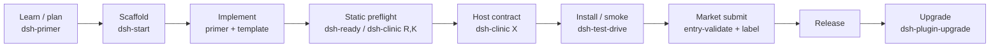

# Plugin developer journey: which tool when

> 非官方 · 非认证 · 非安全审计。工具只做各自的事；市场规则是各自领域的权威。

| Stage | Command | Tool | Output |
|---|---|---|---|
| Learn / plan | `dsh-primer` skill | primer | version matrix, decisions |
| Scaffold | `dsh-dev new` / `dsh-start new` | start | package, patch, index, README, LICENSE |
| Static preflight | `dsh-dev check` / `dsh-ready` | ready | `ready-report.json` |
| Host contract | `dsh-clinic --only R,K,X --dsh-install <dsh>` | clinic | host-contract report |
| Install / smoke | `dsh-test-drive` | test-drive | C3 host evidence |
| Market submit | `entry-validate --meta --host-evidence` | standards | C1–C8 + C3 report |
| Upgrade | `dsh-plugin-upgrade-scan` | upgrade | corridor/migration list |
| Toolchain | `dsh-tools list/doctor/install` | tools | installed/version guide |

## Rules

- `dsh-ready` is **static only**; `host: not-run` is not a pass. Use test-drive for C3.
- `dsh-test-drive` result feeds `entry-validate --host-evidence`; do not hand-write a pass.
- `dsh-score` / `dsh-plugin-certification` are discovery/evidence signals, not preflight gates.
- `dsh-plugin-kit` is internal/reference; it is **not** required.
- No score, ranking, certification, or official claim.

## Repositories

- Family: https://github.com/PerryLink/dsh-plugin-devtools
- Standards: https://github.com/PerryLink/dsh-standards
- Old/new index: [RENAMES.md](../RENAMES.md)
